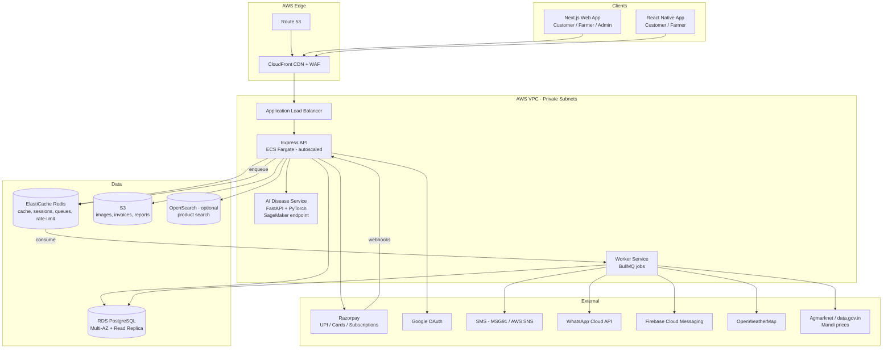

# 1. System Architecture

## 1.1 High-Level View



## 1.2 Architectural Style

**Modular monolith** (single Express codebase, domain-separated modules) + **async workers**. This keeps early development fast while module boundaries allow later extraction into microservices (e.g. `orders`, `notifications`).

| Module | Responsibility |
|---|---|
| `auth` | JWT access/refresh, Google OAuth, OTP, RBAC |
| `users` | Profiles for farmer/customer/admin, addresses |
| `farms` | Farms, locations (PostGIS points/polygons), fields |
| `crops` | Crop cycles, sowing/harvest, schedules, health logs, yield estimation |
| `expenses` | Farm expense tracking & categories |
| `catalog` | Categories, products, variants, images, pricing |
| `inventory` | Stock levels, movements, low-stock alerts |
| `cart` / `wishlist` | Customer shopping state |
| `orders` | Checkout, order lifecycle, tracking, split by farmer |
| `payments` | Razorpay orders, verification, webhooks, refunds |
| `subscriptions` | Recurring deliveries (weekly/monthly) via Razorpay Subscriptions |
| `coupons` | Discount rules, usage limits |
| `reviews` | Ratings & reviews (verified purchase) |
| `notifications` | Push, SMS, WhatsApp, in-app; templating per language |
| `weather` | Forecasts per farm location, alerts |
| `market` | Mandi price ingestion and lookup |
| `ai` | Disease detection proxy, results storage |
| `analytics` | Dashboards, revenue/inventory reports (read replica) |
| `admin` | Moderation, user/product/order management |

## 1.3 Key Flows

### Checkout & Payment
```mermaid
sequenceDiagram
    participant C as Customer App
    participant A as API
    participant DB as PostgreSQL
    participant R as Razorpay
    C->>A: POST /orders/checkout (cart, address, coupon)
    A->>DB: BEGIN; validate stock (SELECT ... FOR UPDATE); reserve stock; create order(PENDING_PAYMENT)
    A->>R: Create Razorpay order (amount in paise)
    A-->>C: razorpay_order_id, key_id
    C->>R: Razorpay Checkout (UPI / Card / Netbanking)
    R-->>C: payment_id, signature
    C->>A: POST /payments/verify
    A->>A: HMAC-SHA256 verify signature
    A->>DB: payment=CAPTURED, order=CONFIRMED; COMMIT
    R-->>A: Webhook payment.captured (idempotent backup)
    A->>A: enqueue notifications (SMS/WhatsApp/Push)
```
Unpaid orders auto-expire after 15 minutes (worker job) and release reserved stock.

### AI Crop Disease Detection
1. Farmer uploads leaf image → pre-signed S3 URL upload.
2. API calls AI service with S3 key → model (e.g. EfficientNet fine-tuned on PlantVillage + local data) returns top-k diseases with confidence.
3. Result stored in `crop_health_logs`, remedies returned in user's language. Low-confidence (<0.6) results flagged "consult expert".

### Reminders & Notifications
- Worker cron (every 15 min) scans `crop_schedules` where `scheduled_at` is due → creates `notifications` → fans out to channels per user preference (FCM / SMS / WhatsApp).
- Weather job (every 3 h) fetches forecasts per farm location; triggers alerts (heavy rain, frost, heat) and can suggest skipping irrigation.
- Market job (daily 7 AM IST) ingests mandi prices into `market_prices`.

## 1.4 Cross-Cutting Concerns

| Concern | Approach |
|---|---|
| AuthN | Short-lived JWT access token (15 min) + rotating refresh token (30 days, hashed in DB, httpOnly cookie on web / SecureStore on mobile) |
| AuthZ | RBAC (`FARMER`, `CUSTOMER`, `ADMIN`) + ownership checks (farmer can only edit own farms/products) |
| Validation | Zod schemas on every request body/query |
| Security | Helmet, CORS allow-list, rate limiting (Redis), bcrypt for passwords, OTP hashed + 5 attempts max, parameterised SQL (Prisma), S3 pre-signed URLs with content-type/size limits, Razorpay signature + webhook secret verification, secrets in AWS Secrets Manager |
| i18n | `next-intl` (web), `i18next` (mobile); content translations stored in `*_translations` tables; notification templates per locale |
| Money | Stored as integer paise (`BIGINT`) to avoid float errors |
| Observability | Pino structured logs → CloudWatch; OpenTelemetry traces → X-Ray; Sentry for FE/BE errors |
| Caching | Redis for product listings, categories, weather, market prices |
| Idempotency | `Idempotency-Key` header on checkout/payment endpoints; webhook event IDs stored |
| Files | S3 + CloudFront; images resized to WebP thumbnails by Lambda on upload |

## 1.5 Tech Choices

| Area | Choice | Reason |
|---|---|---|
| ORM | Prisma | Type-safe, migrations, works with PostgreSQL |
| Queue | BullMQ (Redis) | Simple, reliable delayed/cron jobs |
| Geo | PostGIS | Farm boundaries, nearby farmers, weather by location |
| Web state | TanStack Query + Zustand | Server cache + light client state |
| Mobile | Expo (React Native) | OTA updates, push notifications, camera |
| Shared code | Turborepo monorepo with `packages/shared` | Shared types, Zod schemas, API client, i18n strings |
| Charts | Recharts (web), Victory Native (mobile) | Dashboards |
