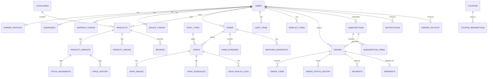

# 2. Database Schema

Full runnable DDL: [../database/schema.sql](../database/schema.sql) (PostgreSQL 15 + PostGIS + pg_trgm + pgvector).

## 2.1 Conventions
- UUID primary keys (`gen_random_uuid()`), `BIGSERIAL` for high-volume append-only logs.
- Money in **paise** (`BIGINT`), currency INR.
- `created_at` / `updated_at` / `deleted_at` (soft delete) on core entities.
- Order data **snapshots** (product name, price, address) so history is immutable.
- Translations in `*_translations` tables keyed by `(id, locale)` — `en`, `te`, `ta`, `hi`.

## 2.2 Entity-Relationship Diagram

## 2.3 Table Summary

| Domain | Tables |
|---|---|
| Auth & Users | `users`, `refresh_tokens`, `otp_codes`, `device_tokens`, `notification_preferences`, `addresses` |
| Farmer | `farmer_profiles`, `farms`, `crop_types`, `crop_type_translations`, `crops`, `crop_images`, `crop_schedules`, `crop_health_logs`, `farm_expenses` |
| Catalog | `categories`, `category_translations`, `products`, `product_translations`, `product_variants`, `product_images`, `price_history`, `stock_movements` |
| Commerce | `cart_items`, `wishlist_items`, `coupons`, `coupon_redemptions`, `orders`, `order_items`, `order_status_history`, `shipments`, `payments`, `payment_webhook_events`, `farmer_payouts` |
| Subscriptions | `subscriptions`, `subscription_items` |
| Engagement | `reviews`, `notification_templates`, `notifications` |
| Data feeds | `weather_snapshots`, `market_prices` |
| Admin | `audit_logs`, `mv_daily_sales` (materialized), `v_inventory_status` (view) |
| Marketing ([08](08-marketing-plan.md)) | `waitlist_signups`, `referral_codes`, `referrals`, `wallet_transactions`, `gift_cards`; `users.referred_by/signup_utm`, `orders.wallet_paise/gift_card_paise/utm` |
| Expansion ([09](09-future-expansion.md)) | `seller_licenses`, `b2b_listings`, `b2b_offers`, `service_listings`, `bookings`, `soil_tests`, `user_consents`, `partner_applications`, `knowledge_chunks` (pgvector), `assistant_messages`; seed/fertilizer traceability columns on `product_variants` |
| Community ([10](10-community.md)) | `follows`, `circles`, `circle_members`, `posts`, `post_media`, `post_translations`, `comments`, `reactions`, `poll_votes`, `conversations`, `conversation_members`, `messages` (partitioned), `dm_settings`, `crop_share_offers`, `crop_share_purchases`, `farmer_tips`, `community_events`, `event_rsvps`, `reputation_ledger`, `user_badges`, `content_reports`, `user_blocks` |

Roles: `FARMER`, `CUSTOMER`, `ADMIN`, `EXPERT` (verifies Q&A answers, consultancy), `SERVICE_PROVIDER` (equipment, drone, soil lab).

## 2.4 Important Rules
- **Stock reservation**: at checkout, `SELECT ... FOR UPDATE` on variants, increment `reserved_qty`. On payment capture: `stock_qty -= qty`, `reserved_qty -= qty`. On expiry/cancel: `reserved_qty -= qty`. Every change writes a `stock_movements` row.
- **Yield estimation**: `estimated_yield_kg = area_acres × crop_types.avg_yield_per_acre_kg × health_factor`, where `health_factor` is derived from latest `crop_health_logs` (1.0 healthy, 0.85 at-risk, 0.6 diseased) and adjusted by weather anomalies.
- **Ratings**: `products.rating_avg/rating_count` updated transactionally on review insert/delete.
- **Reports**: `mv_daily_sales` refreshed `CONCURRENTLY` every hour by worker; analytics queries run on the read replica.
- **Partitioning (scale phase)**: `notifications`, `stock_movements`, `audit_logs`, `market_prices` range-partitioned by month.
