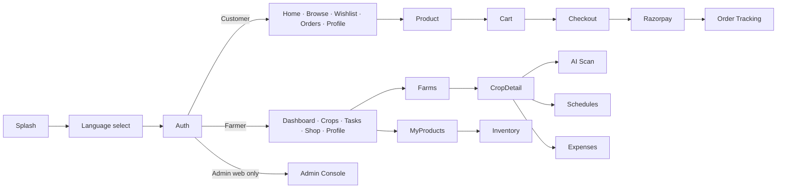

# 4. UI Wireframes

## 4.1 Design System

| Token | Value |
|---|---|
| Primary | `#2E7D32` (leaf green) — hover `#1B5E20` |
| Secondary | `#8BC34A` (fresh lime) |
| Accent | `#F9A825` (harvest gold — honey/ghee highlights, CTAs) |
| Earth | `#6D4C41` (soil brown — secondary text, badges) |
| Background | `#F7FAF5` · Surface `#FFFFFF` |
| Danger / Warning / Info | `#D32F2F` / `#ED6C02` / `#0288D1` |
| Font | Inter (Latin) + Noto Sans Telugu / Tamil / Devanagari |
| Radius | `rounded-2xl` cards, `rounded-full` chips/buttons |
| Breakpoints | Mobile-first: base → `sm 640` → `md 768` → `lg 1024` → `xl 1280` |
| Icons | Lucide (web) / lucide-react-native |

Tailwind theme extension:
```js
colors: {
  primary: { 50:'#E8F5E9', 100:'#C8E6C9', 500:'#4CAF50', 600:'#2E7D32', 700:'#1B5E20' },
  lime:    { 500:'#8BC34A' },
  harvest: { 500:'#F9A825' },
  soil:    { 500:'#6D4C41' },
}
```

Accessibility: WCAG AA contrast, 44px min tap targets, large-text mode for farmers, icon + label navigation, voice-friendly OTP login.

---

## 4.2 Customer — Home (Mobile)
```
┌─────────────────────────────┐
│ 🌿 Farmora      🌐 EN  🔔 🛒3│
├─────────────────────────────┤
│ 🔍 Search honey, millets... │
├─────────────────────────────┤
│ ┌─────────────────────────┐ │
│ │  Pure Forest Honey      │ │  ← hero carousel
│ │  Flat 20% off  [Shop →] │ │
│ └─────────────────────────┘ │
│ Categories                  │
│ (🍯)  (🧈)  (🫒)  (🌾) (🫘)(🌶)│
│ Honey Ghee  Oils Millet ... │
├─────────────────────────────┤
│ Fresh from Farms     See all│
│ ┌──────┐ ┌──────┐ ┌──────┐  │
│ │ img  │ │ img  │ │ img  │  │
│ │A2 Ghee│ │Ragi  │ │Turmer│  │
│ │★4.8   │ │★4.6  │ │★4.7  │  │
│ │₹649 ♡ │ │₹89 ♡ │ │₹199 ♡│  │
│ │[+Add] │ │[+Add]│ │[+Add]│  │
│ └──────┘ └──────┘ └──────┘  │
├─────────────────────────────┤
│ Meet our Farmers  →         │
│ (👨‍🌾 Ravi, Guntur ★4.9) ... │
├─────────────────────────────┤
│ 🏠Home 🔍Browse ♡Wish 📦Orders 👤│
└─────────────────────────────┘
```

## 4.3 Product Listing (Desktop)
```
┌──────────────────────────────────────────────────────────────────────┐
│ 🌿 Farmora  [Honey][Ghee][Oils][Millets][Pulses][Spices]  🔍_____  ♡ 🛒 👤 │
├───────────────┬──────────────────────────────────────────────────────┤
│ FILTERS       │ Millets (48 results)          Sort: [Popular ▾]      │
│ Price         │ ┌────────┐ ┌────────┐ ┌────────┐ ┌────────┐          │
│ ₹0 ━━●━━ ₹2000│ │  img   │ │  img   │ │  img   │ │  img   │          │
│ Rating        │ │Foxtail │ │Ragi    │ │Jowar   │ │Little  │          │
│ ☐ 4★ & above  │ │Organic🏷│ │        │ │Organic🏷│ │        │          │
│ Type          │ │★4.6(212)│ │★4.5(98)│ │★4.7(51)│ │★4.4(33)│         │
│ ☐ Organic     │ │₹120 ̶₹̶1̶5̶0̶│ │₹89    │ │₹110   │ │₹135   │          │
│ ☐ In stock    │ │[Add 🛒]♡│ │[Add 🛒]♡│ │[Add 🛒]♡│ │[Add 🛒]♡│          │
│ Farmer region │ └────────┘ └────────┘ └────────┘ └────────┘          │
│ ☐ Andhra      │                     ‹ 1 2 3 … 6 ›                    │
│ ☐ Tamil Nadu  │                                                      │
└───────────────┴──────────────────────────────────────────────────────┘
```

## 4.4 Product Detail
```
┌─────────────────────────────────────────────────────────────────┐
│ ┌──────────────────┐  A2 Desi Cow Ghee                          │
│ │                  │  by 👨‍🌾 Lakshmi Farms, Kurnool ✔ Verified   │
│ │   main image     │  ★★★★★ 4.8 (320 reviews)                   │
│ │                  │  ₹649  ̶₹̶7̶9̶9̶  19% off                       │
│ └──────────────────┘  Size: (250ml) [500ml] (1L)                │
│ [▫][▫][▫][▫]          Qty: [-] 1 [+]     In stock (42)          │
│                        [ Add to Cart ]  [ Buy Now ]  ♡          │
│                        🔁 Subscribe & save 10%  [Monthly ▾]      │
│                        🚚 Delivery by Oct 15 to 500032 [Change] │
├─────────────────────────────────────────────────────────────────┤
│ [Description] [Farm Story] [Reviews]                            │
│ 5★ ████████████ 78%   │ "Smells like home made ghee..." ★5      │
│ 4★ ███ 15%            │  — Priya, Verified buyer                │
│ ...                   │ [Write a review]                        │
└─────────────────────────────────────────────────────────────────┘
```

## 4.5 Cart & Checkout
```
┌───────────────────────────────┐   ┌───────────────────────────────┐
│ My Cart (3)                   │   │ Checkout       ①Address ②Pay  │
│ ┌───┐ A2 Ghee 500ml   [-]1[+] │   │ Deliver to:                   │
│ │img│ ₹649            🗑      │   │ ◉ Home – Hyderabad 500032     │
│ └───┘                         │   │ ○ Office – Gachibowli         │
│ ┌───┐ Ragi 1kg        [-]2[+] │   │ [+ Add new address]           │
│ │img│ ₹178            🗑      │   │                               │
│ └───┘                         │   │ Payment method:               │
│ Coupon: [FARM20   ] [Apply] ✔ │   │ ◉ UPI (GPay/PhonePe/Paytm)    │
│ ───────────────────────────── │   │ ○ Credit / Debit Card         │
│ Subtotal            ₹1,026    │   │ ○ Net Banking                 │
│ Discount (FARM20)   -₹205     │   │                               │
│ Delivery              FREE    │   │ Total payable: ₹821           │
│ Total               ₹821      │   │ [  Pay ₹821 securely 🔒  ]    │
│ [  Proceed to Checkout  ]     │   │   Powered by Razorpay         │
└───────────────────────────────┘   └───────────────────────────────┘
```

## 4.6 Order Tracking
```
┌───────────────────────────────┐
│ Order #FRM100245              │
│ ● Confirmed      Oct 11 10:02 │
│ │                             │
│ ● Packed         Oct 11 16:40 │
│ │                             │
│ ● Shipped        Oct 12 09:10 │
│ │  Delhivery • 1234567890 [↗] │
│ ○ Out for delivery            │
│ ○ Delivered  (ETA Oct 14)     │
│ [Download Invoice] [Need help]│
└───────────────────────────────┘
```

## 4.7 Farmer Dashboard (Desktop)
```
┌───────────┬──────────────────────────────────────────────────────────┐
│ 🌿 Farmora │ Namaste, Ravi 👋         ☀ 31°C Guntur · Rain tomorrow 🌧 │
│           ├──────────────────────────────────────────────────────────┤
│ 📊 Dashboard│ ┌──────────┐┌──────────┐┌──────────┐┌──────────┐        │
│ 🏡 Farms   │ │Farms   3 ││Crops   7 ││Sales     ││Expenses  │        │
│ 🌱 Crops   │ │12.5 acres││5 growing ││₹48,200   ││₹21,300   │        │
│ 📅 Schedule│ └──────────┘└──────────┘└──────────┘└──────────┘        │
│ 💰 Expenses│ ┌─────────────────────────┐ ┌──────────────────────┐   │
│ 🩺 Health  │ │ Revenue vs Expense (6m) │ │ Today's Tasks         │   │
│ 🛍 Products│ │  ▂▃▅▆▇█  line/bar chart │ │ ☐ 💧 Irrigate Paddy-A │   │
│ 📦 Inventory│ │                         │ │ ☐ 🧪 Urea 50kg Cotton │   │
│ 🧾 Orders  │ └─────────────────────────┘ │ ☑ 🌿 Weeding Chilli   │   │
│ 📈 Mandi   │ ┌─────────────────────────┐ └──────────────────────┘   │
│ ⚙ Settings│ │ Crop Health             │ ┌──────────────────────┐   │
│           │ │ Paddy ● Healthy          │ │ Mandi Prices (Guntur)│   │
│           │ │ Chilli ● At risk ⚠       │ │ Chilli ₹18,500/q ▲3% │   │
│           │ │ Cotton ● Healthy         │ │ Cotton ₹7,200/q  ▼1% │   │
│           │ │ [📷 Scan a leaf]          │ └──────────────────────┘   │
│           │ └─────────────────────────┘  Low stock: Honey 500g (4) ⚠│
└───────────┴──────────────────────────────────────────────────────────┘
```

## 4.8 Farmer — Add Crop (Mobile)
```
┌─────────────────────────────┐
│ ← Add Crop                  │
│ Farm      [North Field   ▾] │
│ Crop      [Paddy (వరి)   ▾] │
│ Variety   [BPT 5204       ] │
│ Season    (Kharif)(Rabi)(Zaid)│
│ Area      [ 2.5 ] acres     │
│ Sowing    [📅 15 Jun 2026 ] │
│ Harvest   [📅 12 Oct 2026 ] │  ← auto-suggested
│ Photos    [📷+] [img] [img] │
│ ☑ Auto-create fertilizer &  │
│   irrigation schedule       │
│ Est. yield: ~5,500 kg       │
│ [        Save Crop        ] │
└─────────────────────────────┘
```

## 4.9 AI Disease Detection (Mobile)
```
┌─────────────────────────────┐   ┌─────────────────────────────┐
│ ← Crop Health Scan          │   │ ← Result                    │
│ ┌─────────────────────────┐ │   │ ┌──────┐ Early Blight        │
│ │                         │ │   │ │ img  │ Confidence 91%      │
│ │   [ camera viewfinder ] │ │   │ └──────┘ Severity: Moderate  │
│ │    Align leaf in frame  │ │   │ ─────────────────────────── │
│ └─────────────────────────┘ │   │ What to do:                 │
│   (🖼 Gallery)  (◉)  (⚡)    │   │ 1. Remove infected leaves   │
│ Tips: good light, 1 leaf    │   │ 2. Spray Mancozeb 2.5 g/L   │
└─────────────────────────────┘   │ 3. Avoid overhead watering  │
                                  │ [🔊 Listen in Telugu]        │
                                  │ [Save to crop log] [Expert] │
                                  └─────────────────────────────┘
```

## 4.10 Expenses
```
┌─────────────────────────────┐
│ Expenses        Oct 2026 ▾  │
│ Total ₹21,300               │
│ ◔ donut: Seeds 20% Fert 35% │
│   Labour 30% Other 15%      │
│ ─────────────────────────── │
│ 🧪 Urea 2 bags   ₹1,200 10/10│
│ 👷 Labour (4)    ₹2,400 09/10│
│ 💧 Diesel pump   ₹800  08/10 │
│                     [＋ Add] │
└─────────────────────────────┘
```

## 4.11 Admin Dashboard
```
┌──────────────┬────────────────────────────────────────────────────────┐
│ Farmora Admin│ [Today][7d][30d][Custom]                    Export CSV  │
│ 📊 Overview  ├────────────────────────────────────────────────────────┤
│ 👨‍🌾 Farmers   │ GMV ₹12.4L ▲8% │ Orders 1,842 │ AOV ₹673 │ New users 312 │
│ 👥 Customers │────────────────────────────────────────────────────────│
│ 🛍 Products  │ ┌ Revenue trend (area chart) ─────┐ ┌ Sales by category ┐│
│   ⏳ Pending 12│ │                                 │ │ ◕ Ghee 32%        ││
│ 🧾 Orders    │ └─────────────────────────────────┘ │   Honey 24% ...   ││
│ 🎟 Coupons   │ ┌ Top farmers ──────────┐ ┌ Inventory alerts ───────────┐│
│ 💸 Payouts   │ │ Lakshmi Farms ₹1.2L   │ │ ⚠ 14 SKUs low stock        ││
│ 📈 Reports   │ │ Ravi Organics ₹98K    │ │ ⛔ 3 SKUs out of stock      ││
│ 🔔 Broadcast │ └───────────────────────┘ └────────────────────────────┘│
│ ⚙ Settings  │ Recent orders  [table: #, customer, amount, status, ⋯]   │
└──────────────┴────────────────────────────────────────────────────────┘
```

## 4.12 Auth (Mobile)
```
┌─────────────────────────────┐   ┌─────────────────────────────┐
│        🌿 Farmora            │   │ ← Verify OTP                │
│  Language: EN | తె | த | हि   │   │ Sent to +91 98765 43210     │
│                             │   │ [ 4 ][ 7 ][ 2 ][ 9 ][ 1 ][ 5 ]│
│  I am a: (Customer)(Farmer) │   │ Resend in 0:28              │
│  📱 +91 [__________]        │   │ [        Verify          ]  │
│  [   Get OTP   ]            │   └─────────────────────────────┘
│  ──────── or ────────       │
│  [ G  Continue with Google ]│
│  Use email & password       │
└─────────────────────────────┘
```

## 4.13 Navigation Map

