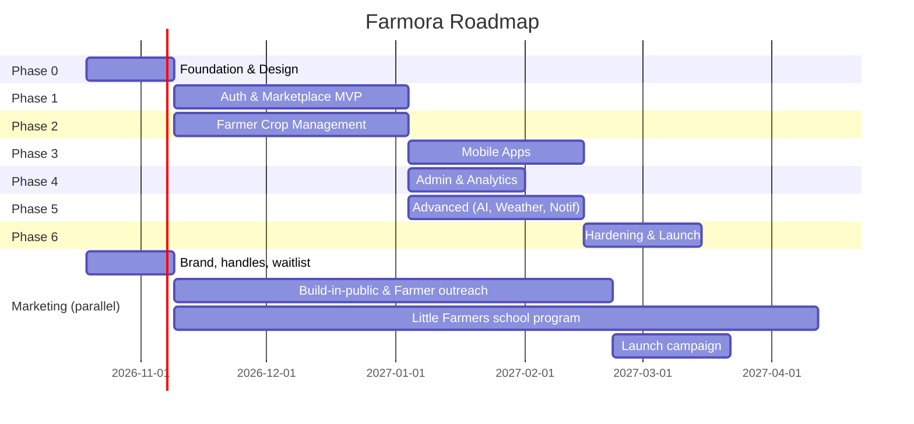

# 6. Development Roadmap

Team assumption: 2 backend, 2 web, 1–2 mobile, 1 ML/data, 1 designer, 1 QA, 1 DevOps (part-time). Two-week sprints.

> Marketing runs in parallel from day 1. See [08-marketing-plan.md](08-marketing-plan.md).

## Phase 0 — Foundation
- Monorepo (Turborepo, pnpm), ESLint/Prettier, Husky, commitlint
- Docker Compose local stack (Postgres+PostGIS, Redis, LocalStack S3)
- Prisma schema + migrations from `database/schema.sql`, seed data
- CI pipeline (lint, typecheck, unit tests)
- Terraform for dev environment
- Design system in Figma, Tailwind tokens, i18n setup with 4 locales
- Waitlist landing page (role + referral code), social handles reserved
- **Exit**: running skeleton on dev AWS, design approved

## Phase 1 — Auth & Marketplace MVP (web)
- Auth: register/login, JWT + refresh rotation, OTP (MSG91/SNS), Google login, RBAC
- Catalog: categories, products, variants, images (S3 pre-signed), search & filters
- Farmer: product CRUD, pricing, stock management, inventory view
- Customer: browse, PDP, cart, wishlist, addresses
- Checkout: stock reservation, coupons, Razorpay (UPI, cards, netbanking), webhooks, order expiry
- Orders: status lifecycle, tracking timeline, farmer fulfillment, invoices
- Reviews & ratings (verified purchase)
- Marketing hooks: referral codes & wallet credits, UTM tracking, WhatsApp share, farmer storefront story page
- **Exit**: end-to-end purchase in Razorpay test mode

## Phase 2 — Farmer Crop Management (parallel with Phase 1)
- Farm profile, farms with map location (Leaflet/Google Maps)
- Crops: sowing/harvest dates, images, status
- Fertilizer & irrigation schedules (templates per crop type)
- Expense tracking + charts
- Yield estimation v1 (rule-based)
- Farmer dashboard
- **Exit**: farmer manages full crop cycle on web

## Phase 3 — Mobile Apps (React Native / Expo)
- Shared `api-client`, `i18n`, `ui-tokens`
- Customer flows: browse → cart → Razorpay RN SDK checkout → tracking
- Farmer flows: dashboard, crops, camera uploads, tasks, offline-tolerant forms (React Query persistence)
- Push notifications (FCM via Expo)
- Internal testing via TestFlight / Play Internal track
- **Exit**: feature parity for core customer & farmer flows

## Phase 4 — Admin & Analytics
- Farmer KYC verification, product approval queue
- Customer/order management, refunds, coupons
- Dashboards: sales, revenue, crop, inventory analytics
- Revenue & inventory reports with CSV export
- Farmer payouts (Razorpay Route)
- Audit logs
- **Exit**: ops team can run the marketplace without DB access

## Phase 5 — Advanced Features
- Weather integration (OpenWeatherMap One Call) + alerts, irrigation suggestions
- AI crop disease detection: train on PlantVillage + field images, FastAPI service, SageMaker endpoint, localized remedies
- Crop growth reminders (worker cron)
- SMS (DLT-registered templates), WhatsApp Cloud API templates, push
- Market (mandi) price ingestion from data.gov.in/Agmarknet + trends
- Subscription orders (Razorpay Subscriptions, pause/skip/resume)
- Full Telugu/Tamil/Hindi translations reviewed by native speakers
- **Exit**: all advanced features in staging

## Phase 6 — Hardening & Launch
- Security: OWASP ASVS L2 review, external pen test, dependency scanning
- Load testing (k6): 500 RPS browse, 50 checkouts/s
- Performance: Lighthouse ≥ 90 mobile, image optimization, caching
- Accessibility audit (WCAG AA)
- Razorpay live KYC, legal (T&C, Privacy Policy per DPDP Act 2023, refund policy)
- App Store / Play Store submission
- Beta with 50 farmers + 500 customers → public launch
- **Exit**: production go-live

## Post-Launch: Agri Super-App Expansion
Detailed in [09-future-expansion.md](09-future-expansion.md).
- **Community (social network):** v1 Connect ships with mobile apps; v2 Learn & Talk at launch + 3 months; v3 Grow Together at launch + 6 months. See [10-community.md](10-community.md)
- **Wave 1 (Engagement):** AI farming assistant chatbot (voice, 4 languages), soil testing service, farmer-to-farmer marketplace
- **Wave 2 (Inputs & Services):** seed marketplace, fertilizer marketplace, equipment rental, drone spraying booking
- **Wave 3 (Expert & Finance):** agricultural consultancy, crop insurance (partner), agri loans (partner)
- Ongoing: logistics integration (Shiprocket/Delhivery), recommendation engine, satellite (NDVI) crop health

## Definition of Done (every story)
- Unit + integration tests (≥ 80% service coverage)
- API documented in OpenAPI
- Strings externalized in all 4 locales
- Mobile + desktop responsive verified
- Reviewed PR, CI green, deployed to staging
