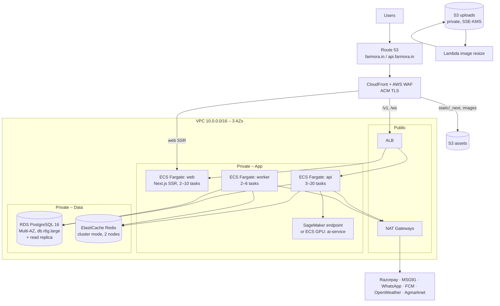
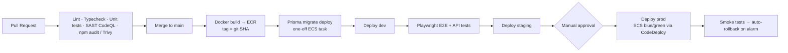

# 7. Production Deployment Plan (AWS, region `ap-south-1` Mumbai)

## 7.1 Infrastructure

| Component | Service | Prod sizing (launch) |
|---|---|---|
| Web (Next.js SSR) | ECS Fargate (or AWS Amplify Hosting) | 2 × 1 vCPU/2 GB, autoscale CPU 60% |
| API | ECS Fargate behind ALB | 3 × 1 vCPU/2 GB, autoscale to 20 |
| Worker | ECS Fargate | 2 × 0.5 vCPU/1 GB, scale on queue depth |
| AI inference | SageMaker real-time (ml.g4dn.xlarge) or serverless inference | 1, autoscale |
| Database | RDS PostgreSQL 16 Multi-AZ + 1 read replica | db.r6g.large, gp3 200 GB, PITR 14 d |
| Cache/Queue | ElastiCache Redis 7 | cache.r6g.large × 2 |
| Storage | S3 (uploads, assets, invoices, backups) | Lifecycle → IA after 90 d |
| CDN/Security | CloudFront, WAF (managed rules + rate rules), Shield Std | |
| Secrets | Secrets Manager + KMS | rotation for DB creds |
| DNS/TLS | Route 53, ACM | |
| Email | SES | |
| Mobile builds | Expo EAS → App Store / Play Store; EAS Update for OTA | |

## 7.2 Environments

| Env | Purpose | Notes |
|---|---|---|
| `local` | Dev | Docker Compose |
| `dev` | Integration | Auto-deploy from `main`, smallest instances, single-AZ |
| `staging` | UAT / pre-prod | Prod-like, Razorpay test mode, anonymized data |
| `prod` | Live | Multi-AZ, manual approval gate |

All infra as code via **Terraform** (`infra/terraform/envs/*`), state in S3 + DynamoDB lock.

## 7.3 CI/CD (GitHub Actions)

- GitHub OIDC → AWS IAM role (no long-lived keys).
- DB migrations are backwards-compatible (expand → migrate → contract).
- Mobile: `eas build` on tag `mobile-v*`, `eas submit` to stores; JS-only fixes via `eas update` channels.

## 7.4 Security Checklist
- WAF: AWS managed Core/SQLi/Known-bad-inputs, rate-based rule on `/v1/auth/*`
- All data stores in private subnets; security groups least-privilege; no public RDS
- Encryption at rest (KMS) for RDS, Redis, S3; TLS 1.2+ in transit
- Secrets only in Secrets Manager; injected as ECS task secrets
- Razorpay webhook signature verification; payment amounts computed server-side only
- S3 uploads via pre-signed URLs, content-type & size restricted, private bucket served via CloudFront signed URLs/OAC
- IAM task roles scoped per service
- GuardDuty, Security Hub, CloudTrail enabled
- PII minimization & DPDP Act compliance (consent for WhatsApp/SMS, data deletion endpoint)
- Dependabot + Trivy image scanning; quarterly pen tests

## 7.5 Observability
| Concern | Tool |
|---|---|
| Logs | Pino JSON → CloudWatch Logs (30 d), archived to S3 |
| Metrics | CloudWatch Container Insights + custom (orders/min, payment failures, queue depth) |
| Tracing | OpenTelemetry → AWS X-Ray |
| Errors | Sentry (web, mobile, api) |
| Uptime | CloudWatch Synthetics canaries (home, search, checkout API) |
| Alerting | CloudWatch Alarms → SNS → Slack/PagerDuty |

Key SLOs: API availability 99.9%, p95 latency < 300 ms (read) / < 800 ms (checkout), payment success ≥ 95%.

## 7.6 Backup & Disaster Recovery
- RDS automated backups + PITR (14 days), daily snapshot copied to `ap-southeast-1`
- S3 versioning + cross-region replication for uploads
- **RPO** 5 min, **RTO** 1 h; DR runbook tested quarterly
- Redis is non-authoritative (queues are rebuildable from DB state)

## 7.7 Scaling Strategy
1. Horizontal ECS autoscaling (CPU, request count, queue depth)
2. Redis caching for catalog/category/weather/market endpoints; CloudFront caching for public GETs (`s-maxage` + SWR)
3. Read replica for analytics/reports
4. OpenSearch for product search when catalog > 50k SKUs
5. Table partitioning for logs/notifications
6. Extract `notifications` and `orders` into separate services if team/load demands

## 7.8 Cost Estimate (launch, monthly, approx.)
| Item | USD |
|---|---|
| ECS Fargate (web/api/worker) | 250 |
| RDS Multi-AZ + replica | 450 |
| ElastiCache | 220 |
| NAT Gateways | 100 |
| ALB + CloudFront + WAF | 120 |
| S3 + data transfer | 50 |
| SageMaker (serverless inference) | 80 |
| CloudWatch / misc | 80 |
| **Total** | **≈ $1,350** |

Cost levers: Savings Plans, Graviton (arm64) images, single NAT in non-prod, scheduled shutdown of dev/staging.

## 7.9 Go-Live Checklist
- [ ] Razorpay live keys, KYC complete, webhook URL registered
- [ ] DLT registration for SMS templates; WhatsApp Business templates approved
- [ ] Google OAuth consent screen verified
- [ ] Domain, SSL, SPF/DKIM/DMARC for SES
- [ ] Load & pen tests passed, findings closed
- [ ] Backups verified with restore drill
- [ ] Alarms & on-call rotation configured
- [ ] Privacy policy, T&C, refund/shipping policy published
- [ ] App store listings in 4 languages
- [ ] Rollback plan documented
