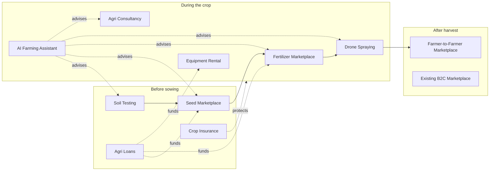
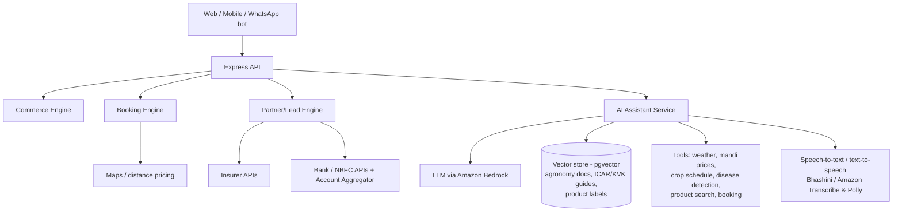
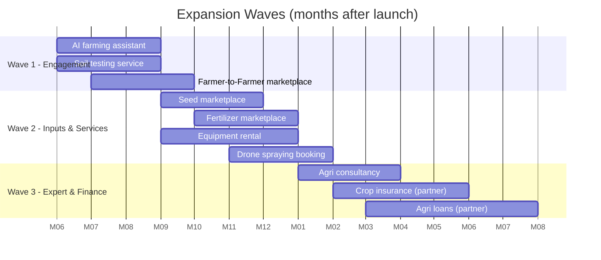

# 9. Future Expansion: Farmora Agri Super-App

Farmora's long-term goal is to be the **one app a farmer opens for everything**: buy inputs, hire services, get advice, get finance, and sell produce. Every feature below reuses the existing users, farms, crops, catalog, orders, payments and notification modules.



## 9.1 Feature Summary

| # | Feature | What it does | Revenue model | Regulatory note |
|---|---|---|---|---|
| 1 | **Farmer-to-Farmer marketplace** | Farmers trade bulk produce, seedlings, cattle feed, manure and used equipment with each other. Includes bulk/negotiated pricing and escrow payment. | 1–2% transaction fee | GST on B2B invoices; APMC rules vary by state |
| 2 | **Equipment rental** | Hourly/daily rental of tractors, harvesters, rotavators and sprayers from owners or Custom Hiring Centres. Shows availability calendar, operator option and distance-based pricing. | 8–12% booking commission | Owner KYC, damage deposit, rental agreement |
| 3 | **Seed marketplace** | Certified and truthfully-labelled seeds from licensed dealers and companies. Shows lot number, germination %, expiry and crop-type matching. | Margin / seller commission | Seller must hold a **seed dealer licence** (Seeds Act 1966, Seed Control Order 1983); lot traceability is mandatory |
| 4 | **Fertilizer marketplace** | Fertilizers, bio-fertilizers and micronutrients recommended from the soil test and crop schedule. | Margin / commission | Seller needs a **fertilizer dealer authorisation** (Fertilizer Control Order 1985); subsidised urea/DAP sales follow the government PoS/Aadhaar process. Pesticides need a licence under the Insecticides Act 1968 |
| 5 | **Drone spraying booking** | Book a certified drone operator per acre. Shows slot booking, a weather check, and a spray log with chemical and dosage. | Per-acre commission | Operator needs **DGCA Remote Pilot Certificate** + registered drone (Drone Rules 2021); follow the government's approved procedure for drone pesticide spraying |
| 6 | **Soil testing service** | Book sample pickup → partner lab → digital Soil Health Card → automatic fertilizer plan in the crop schedule. | Per-test fee; leads into fertilizer sales | Use NABL-accredited or government labs; follow the Soil Health Card scheme format |
| 7 | **Agricultural consultancy** | Video, voice or chat with agronomists, vets (livestock) and horticulture experts. Includes field visits, paid plans and an escalation path from AI disease detection. | Per-session fee / subscription | Verify expert credentials; recommendations are logged |
| 8 | **Crop insurance** | Compare and buy crop or weather insurance, PMFBY enrolment assistance, claim tracking, automatic photo evidence from crop logs. | Insurer commission | Must be an **IRDAI-licensed corporate agent / web aggregator** or partner with one. Farmora does **not** underwrite insurance itself |
| 9 | **Agri loans** | Kisan Credit Card, crop loans, equipment EMI and input credit through partner banks and NBFCs. Farm data (crops, yield, sales history) supports credit scoring. | Lender sourcing fee | **RBI Digital Lending Guidelines 2022**: Farmora acts only as an agent for the lender, which must be RBI-regulated. Loan money goes straight between lender and borrower accounts, never through Farmora. Show the lender's Key Fact Statement and require explicit consent before sharing farm data. Farmora does not lend |
| 10 | **AI farming assistant chatbot** | Voice and text assistant in Telugu, Tamil, Hindi and English: "What should I spray for leaf curl?", "When to irrigate?", "Today's chilli price?". Knows the farmer's crops, weather and soil data. | Free (drives usage of every other feature) | Show "advice, not a guarantee" disclaimers; never auto-recommend banned chemicals; route serious cases to a human expert |

---

## 9.2 Architecture Changes

Most new features fall into **three reusable engines**, so we build three engines rather than ten separate systems.

| Engine | Powers | Reuses |
|---|---|---|
| **Commerce engine** (extend existing catalog/orders) | F2F marketplace, seeds, fertilizers | `products`, `product_variants`, `orders`, `payments`, `inventory` + new `seller_licenses`, B2B pricing, escrow |
| **Booking engine** (new) | Equipment rental, drone spraying, soil testing, consultancy | `users`, `farms` (location), `payments`, `notifications` |
| **Partner/Lead engine** (new) | Insurance, loans | Consent management, partner API integrations, status webhooks |

Plus an **AI layer** shared by the chatbot, disease detection and yield estimation.



### New API Modules
```
apps/api/src/modules/
├── b2b-marketplace/     # bulk listings, offers/negotiation, escrow
├── seller-licenses/     # seed/fertilizer/pesticide licence verification
├── bookings/            # generic booking engine
│   ├── equipment/  drone/  soil-testing/  consultancy/
├── insurance/           # quotes, policies, claims (partner)
├── loans/               # applications, consent, status (partner)
└── assistant/           # chat sessions, tool calling, RAG
```

### Representative Endpoints
| Method | Endpoint | Description |
|---|---|---|
| GET/POST | `/b2b/listings` | Bulk produce listings (min qty, price per quintal) |
| POST | `/b2b/listings/:id/offers` | Make / counter offer |
| GET | `/services?type=EQUIPMENT\|DRONE\|SOIL_TEST\|CONSULT&lat&lng` | Nearby service listings |
| GET | `/services/:id/availability?from&to` | Free slots |
| POST | `/bookings` | `{ serviceId, farmId, slotStart, slotEnd, acres? }` |
| PATCH | `/bookings/:id` | Accept / start / complete / cancel (provider) |
| POST | `/bookings/:id/report` | Spray log / soil report / consultation notes |
| GET | `/insurance/quotes?cropId` | Partner quotes |
| POST | `/insurance/policies` | Purchase via partner |
| POST | `/insurance/claims` | Raise claim with crop photos/health logs |
| POST | `/loans/applications` | Apply (with explicit data-sharing consent) |
| GET | `/loans/applications/:id` | Status from lender |
| POST | `/assistant/chat` | `{ sessionId?, message, audio? }`: streamed reply |

---

## 9.3 Database Additions (included in [database/schema.sql](../database/schema.sql))

```sql
CREATE TYPE service_type   AS ENUM ('EQUIPMENT', 'DRONE', 'SOIL_TEST', 'CONSULTANCY');
CREATE TYPE booking_status AS ENUM ('REQUESTED', 'ACCEPTED', 'IN_PROGRESS', 'COMPLETED', 'CANCELLED', 'DISPUTED');
CREATE TYPE license_type   AS ENUM ('SEED', 'FERTILIZER', 'PESTICIDE', 'DRONE_PILOT', 'INSURANCE_AGENT');

-- Regulated sellers/providers must have a verified, unexpired licence
CREATE TABLE seller_licenses (
    id             UUID PRIMARY KEY DEFAULT gen_random_uuid(),
    user_id        UUID NOT NULL REFERENCES users(id),
    type           license_type NOT NULL,
    license_number VARCHAR(60) NOT NULL,
    issuing_authority VARCHAR(120),
    document_s3_key TEXT NOT NULL,
    valid_until    DATE NOT NULL,
    verified_by    UUID REFERENCES users(id),
    verified_at    TIMESTAMPTZ,
    UNIQUE (type, license_number)
);

-- Seed/fertilizer traceability
ALTER TABLE product_variants
    ADD COLUMN lot_number VARCHAR(40),
    ADD COLUMN manufactured_on DATE,
    ADD COLUMN expires_on DATE,
    ADD COLUMN required_license license_type;

-- B2B farmer-to-farmer
CREATE TABLE b2b_listings (
    id            UUID PRIMARY KEY DEFAULT gen_random_uuid(),
    seller_id     UUID NOT NULL REFERENCES users(id),
    crop_id       UUID REFERENCES crops(id),
    commodity     VARCHAR(80) NOT NULL,
    quantity_kg   NUMERIC(12,2) NOT NULL,
    min_order_kg  NUMERIC(12,2) NOT NULL,
    price_per_qtl_paise BIGINT NOT NULL,
    negotiable    BOOLEAN NOT NULL DEFAULT TRUE,
    location      GEOGRAPHY(POINT, 4326),
    status        VARCHAR(20) NOT NULL DEFAULT 'OPEN',
    created_at    TIMESTAMPTZ NOT NULL DEFAULT now()
);
CREATE TABLE b2b_offers (
    id            UUID PRIMARY KEY DEFAULT gen_random_uuid(),
    listing_id    UUID NOT NULL REFERENCES b2b_listings(id) ON DELETE CASCADE,
    buyer_id      UUID NOT NULL REFERENCES users(id),
    quantity_kg   NUMERIC(12,2) NOT NULL,
    price_per_qtl_paise BIGINT NOT NULL,
    status        VARCHAR(20) NOT NULL DEFAULT 'PENDING',  -- PENDING/COUNTERED/ACCEPTED/REJECTED
    parent_offer_id UUID REFERENCES b2b_offers(id),
    created_at    TIMESTAMPTZ NOT NULL DEFAULT now()
);

-- Generic booking engine
CREATE TABLE service_listings (
    id            UUID PRIMARY KEY DEFAULT gen_random_uuid(),
    provider_id   UUID NOT NULL REFERENCES users(id),
    type          service_type NOT NULL,
    title         VARCHAR(150) NOT NULL,
    details       JSONB,                 -- equipment model/HP, drone capacity, lab tests offered, expert specialisation
    price_unit    VARCHAR(20) NOT NULL,  -- HOUR | DAY | ACRE | TEST | SESSION
    price_paise   BIGINT NOT NULL,
    deposit_paise BIGINT NOT NULL DEFAULT 0,
    service_radius_km SMALLINT,
    location      GEOGRAPHY(POINT, 4326),
    is_active     BOOLEAN NOT NULL DEFAULT TRUE
);
CREATE INDEX idx_service_listings_geo ON service_listings USING GIST(location);

CREATE TABLE bookings (
    id            UUID PRIMARY KEY DEFAULT gen_random_uuid(),
    service_id    UUID NOT NULL REFERENCES service_listings(id),
    farmer_id     UUID NOT NULL REFERENCES users(id),
    farm_id       UUID REFERENCES farms(id),
    crop_id       UUID REFERENCES crops(id),
    slot_start    TIMESTAMPTZ NOT NULL,
    slot_end      TIMESTAMPTZ NOT NULL,
    quantity      NUMERIC(10,2) NOT NULL,  -- hours/days/acres/tests
    total_paise   BIGINT NOT NULL,
    status        booking_status NOT NULL DEFAULT 'REQUESTED',
    report        JSONB,                   -- spray log, soil results, consult notes
    report_s3_key TEXT,
    payment_id    UUID REFERENCES payments(id),
    created_at    TIMESTAMPTZ NOT NULL DEFAULT now(),
    CHECK (slot_end > slot_start)
);

CREATE TABLE soil_tests (
    id            UUID PRIMARY KEY DEFAULT gen_random_uuid(),
    booking_id    UUID REFERENCES bookings(id),
    farm_id       UUID NOT NULL REFERENCES farms(id),
    ph NUMERIC(4,2), ec NUMERIC(6,3), organic_carbon NUMERIC(5,2),
    n_kg_ha NUMERIC(8,2), p_kg_ha NUMERIC(8,2), k_kg_ha NUMERIC(8,2),
    micronutrients JSONB,                  -- S, Zn, Fe, Cu, Mn, B
    tested_on     DATE NOT NULL
);

-- Partner integrations: insurance & loans
CREATE TABLE user_consents (
    id            UUID PRIMARY KEY DEFAULT gen_random_uuid(),
    user_id       UUID NOT NULL REFERENCES users(id),
    purpose       VARCHAR(60) NOT NULL,    -- LOAN_DATA_SHARE, INSURANCE_DATA_SHARE
    partner       VARCHAR(80) NOT NULL,
    data_scope    TEXT[] NOT NULL,
    granted_at    TIMESTAMPTZ NOT NULL DEFAULT now(),
    revoked_at    TIMESTAMPTZ
);
CREATE TABLE partner_applications (
    id            UUID PRIMARY KEY DEFAULT gen_random_uuid(),
    user_id       UUID NOT NULL REFERENCES users(id),
    kind          VARCHAR(20) NOT NULL,    -- INSURANCE | LOAN
    partner       VARCHAR(80) NOT NULL,
    product_code  VARCHAR(60),
    consent_id    UUID NOT NULL REFERENCES user_consents(id),
    external_ref  VARCHAR(80),
    status        VARCHAR(30) NOT NULL,
    amount_paise  BIGINT,
    payload       JSONB,
    created_at    TIMESTAMPTZ NOT NULL DEFAULT now(),
    updated_at    TIMESTAMPTZ NOT NULL DEFAULT now()
);

-- AI assistant
CREATE EXTENSION IF NOT EXISTS vector;
CREATE TABLE knowledge_chunks (
    id         BIGSERIAL PRIMARY KEY,
    source     VARCHAR(120) NOT NULL,
    locale     locale_code NOT NULL,
    content    TEXT NOT NULL,
    embedding  VECTOR(1024)
);
CREATE TABLE assistant_messages (
    id         BIGSERIAL PRIMARY KEY,
    session_id UUID NOT NULL,
    user_id    UUID NOT NULL REFERENCES users(id) ON DELETE CASCADE,
    role       VARCHAR(10) NOT NULL,       -- user | assistant | tool
    content    TEXT NOT NULL,
    tool_calls JSONB,
    feedback   SMALLINT,                   -- -1 / 1
    created_at TIMESTAMPTZ NOT NULL DEFAULT now()
);
```

---

## 9.4 Rollout Waves (after main launch)



| Wave | Why this order |
|---|---|
| **1. Engagement** | The AI assistant and soil tests bring farmers back to the app daily and create the data that powers later recommendations. The F2F marketplace reuses the existing commerce code |
| **2. Inputs & Services** | Recommendations from soil test results drive seed and fertilizer sales. The booking engine is built once and reused for equipment and drones |
| **3. Expert & Finance** | Needs trust, licensing and partner contracts. The farm data history gathered in Waves 1–2 makes credit and insurance assessment possible |

---

## 9.5 Partner Ecosystem

| Area | Potential partners |
|---|---|
| Seeds / fertilizers | State seed corporations, IFFCO, Coromandel, NFL, licensed local dealers |
| Equipment | Custom Hiring Centres, tractor dealers, FPO-owned equipment banks |
| Drones | Certified drone service startups, Drone Didi SHG operators |
| Soil testing | State soil testing labs, KVKs, NABL-accredited private labs |
| Consultancy | Agricultural universities, retired agriculture officers, veterinary colleges |
| Insurance | PMFBY-empanelled insurers, IRDAI-licensed aggregators |
| Loans | Regional rural banks, cooperative banks, agri-NBFCs, Account Aggregator network |
| AI / language | Bhashini (Indian-language speech and translation), Amazon Bedrock, ICAR content |

---

## 9.6 Risks & Safeguards

| Risk | Safeguard |
|---|---|
| Counterfeit seeds/fertilizers | Licence verification, lot tracking, verified-seller badge, complaint → automatic delisting |
| Unsafe chemical advice from AI | Answers only from approved chemical lists, dosage pulled from product labels only, escalation to a human expert, banned-pesticide blocklist |
| Equipment damage / no-shows | Deposits, check-in/out photos, ratings both ways, dispute flow |
| Drone safety | DGCA-certified pilots only, no-fly zone check, weather gate (wind/rain), spray log |
| Financial mis-selling | Partners only, standardised disclosures, explicit consent, cooling-off period info, no loan money passes through Farmora |
| Data privacy | Purpose-specific consent (DPDP Act), revocable at any time, minimum data shared with partners |
