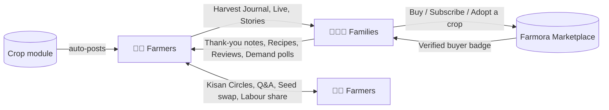
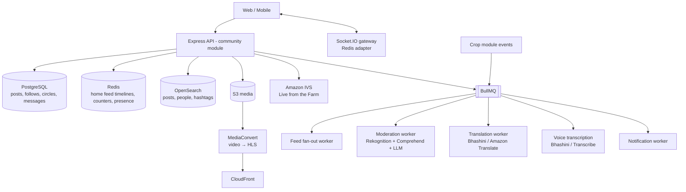

# 10. Farmora Community: Social Network for Farmers & Families

A social layer built into Farmora (web + mobile) that connects:

- **Farmer ↔ Family:** families see *who* grows their food and *how*. Farmers get loyal customers, feedback and pride.
- **Farmer ↔ Farmer:** farmers learn from each other, solve problems together, and share resources.

It is **not** a generic social network. Every feature is tied to farms, crops, food and trust, and connects back to the marketplace.



---

## 10.1 Feature Set

### A. Farmer ↔ Family

| Feature | Description |
|---|---|
| **Farmer profile** | Cover photo, story, farm map pin, certifications, followers, and tabs: *Posts · Shop · Crops · Reviews · Visits* |
| **Follow farmers** | Families follow the farmers they buy from (automatic follow suggestion after the first order) |
| **Harvest Journal (auto-posts)** | Crop module events become posts automatically: "🌱 Sowed ragi on 2 acres", "💧 Irrigation done", "🌾 Harvest started!". The farmer approves with one tap. No extra work |
| **Farm Stories** | 24-hour photo and video stories from the field |
| **Live from the Farm** | Live video of honey harvesting, ghee making or millet threshing, with a **"Buy now"** product pin (live commerce) |
| **Product → Farmer link** | Every product page and delivery-box QR code opens the farmer's profile and journal |
| **Thank Your Farmer** | Families send thank-you notes, photos of meals cooked, and optional **tips** via UPI through Razorpay. Shown on a farmer's "Gratitude Wall" |
| **Family recipes** | Families post recipes made with Farmora products and tag the farmer and product (shoppable recipe) |
| **Ask the Farmer** | Public Q&A on product pages and farmer profiles ("Is this ghee bilona-method?") |
| **Verified buyer badge** | Only real customers can post reviews and thank-you notes, which reduces fake content |

### B. Farmer ↔ Farmer

| Feature | Description |
|---|---|
| **Kisan Circles** | Groups by crop (Chilli Growers), district (Guntur Farmers), language, or interest (Organic, Beekeeping, Dairy). Created automatically from farm data, so farmers join relevant circles on day 1 |
| **Krishi Q&A** | Ask with photo or voice → peers answer → experts can mark an answer **"✔ Expert verified"** → the AI assistant suggests an answer instantly |
| **Pest & disease alert map** | Anonymised, clustered AI disease detections shown on a map: "Pink bollworm reported by 12 farmers within 10 km". Neighbours get an alert in advance |
| **Seed swap** | Exchange traditional/heirloom seeds (non-commercial, no payment) |
| **Labour & equipment sharing** | Post "Need 6 workers for harvest on Oct 20" or "Tractor free this week", linked to the equipment rental booking engine |
| **Success stories** | "My Farm Journey" posts with before/after yield and income (opt-in data from the farmer's dashboard) |
| **Mandi talk** | A discussion thread attached to each commodity's daily mandi price |
| **Mentorship** | Experienced farmers ("Krishi Guru") mentor new or young farmers. Mentors earn badges and featured status |

### C. My Additional Ideas

| Idea | Why it matters |
|---|---|
| **🎙 Voice-first posting** | Many farmers prefer speaking over typing. Record a voice note → auto-transcribe → auto-translate. A Telugu farmer's post can be read in Tamil, Hindi or English by any family |
| **🌐 Cross-language feed** | Every post is auto-translated into the viewer's language, with a "See original" option. This breaks the language barrier between states |
| **🌾 Adopt-a-Crop (community-supported agriculture)** | Families pre-pay for a share of a farmer's crop (e.g. 10 kg of turmeric). They follow its growth in the Harvest Journal and receive the harvest. Farmers get **cash before harvest, without needing a loan** |
| **📊 Demand polls** | Farmers ask followers "Should I grow foxtail millet next season?" and get pre-commitments, so they grow what families will actually buy |
| **🏡 Farm visits & farm stays** | Book a weekend farm visit, pick-your-own or a farm stay (agri-tourism). Links to the Little Farmers program (see marketing plan) |
| **👨‍👩‍👧 Family accounts** | One parent account with household members. Kids see a curated "Little Farmers" feed with **no comments, no DMs and no data collection** (DPDP Act compliant) |
| **🛒 Group buying** | Families in an apartment community pool orders from a farmer for bulk pricing and shared delivery |
| **🏆 Reputation & points** | "Harvest Points" for helpful answers, recipes and reviews, redeemable as coupons. Badges for farmers: *Organic Champion, Top Helper, 100 Happy Families* |
| **📅 Community events** | Farmer melas, organic markets, workshops and webinars with RSVP |
| **🤝 Farmer Collectives** | Farmers in a circle can form a group listing to fulfil large orders together (links to the farmer-to-farmer marketplace) |
| **📰 Smart feed** | Ranked by relationship (farmers you bought from), locality, crop season and language, not just engagement. No endless doom-scroll, with a "You're all caught up" end |

---

## 10.2 Trust & Safety (built in from day 1)

| Risk | Safeguard |
|---|---|
| Harmful chemical advice in Q&A | Posts mentioning pesticides or dosages are auto-flagged → shown with "⚠ Not verified, consult expert" until expert review. Banned-pesticide blocklist |
| Scams / off-platform payments | DMs scanned for UPI IDs and payment requests on first contact → warning banner. Farmers can only sell through Farmora checkout (with buyer protection) |
| Fake farmers / fake reviews | KYC-verified farmer badge, verified-buyer badge, rate limits, device fingerprinting |
| Harassment / spam | DMs from families to farmers only after following *and* ordering, or if the farmer allows it. Block, mute, report on everything |
| Offensive media | Automated moderation: Amazon Rekognition (images/video), Comprehend + LLM classifier (text, in 4 languages) → human review queue |
| Children | No child logins; kids' feed curated by Farmora only, under a parent account; no tracking or targeted ads; parental consent for any child photo |
| Misinformation | Expert-verified labels, community notes on viral posts, links to official ICAR/KVK sources |
| Adopt-a-Crop pre-payments | Structured strictly as an advance purchase of produce (not an investment or returns scheme). Funds released to the farmer in stages, with clear crop-failure refund terms shown before payment. Legal review before launch |
| Legal compliance | **IT Rules 2021:** grievance officer, 24-hour acknowledgement and 15-day resolution, takedown on lawful orders. If India users exceed **5 million**, the stricter large-platform rules apply (Chief Compliance Officer, monthly compliance reports). **DPDP Act:** consent, data export and deletion |

---

## 10.3 Architecture



| Concern | Approach |
|---|---|
| **Feed** | Hybrid fan-out: on write for normal users (push post IDs to followers' Redis lists, capped at 800), on read for accounts with more than 10k followers. Ranking mixes recency, relationship, locality, language and season |
| **Chat** | Socket.IO with a Redis adapter; messages stored in Postgres (partitioned monthly). Delivered/read receipts; FCM push when offline. Move to DynamoDB if volume demands |
| **Media** | Pre-signed S3 upload → Lambda creates thumbnails; video transcoded to HLS; served via CloudFront |
| **Live** | Amazon IVS (low-latency) with a chat overlay and pinned product cards |
| **Translation** | Translate once per target locale on post creation, cache in `post_translations` |
| **Counters** | Likes and comment counts in Redis, flushed to Postgres periodically |
| **Search** | OpenSearch index for posts, people, circles and hashtags (multilingual analyzers) |

### Module Layout
```
apps/api/src/modules/community/
├── profiles/      follows/      feed/
├── posts/         comments/     reactions/
├── stories/       live/         circles/
├── questions/     messages/     events/
├── adoptions/     polls/        tips/
├── moderation/    reports/      reputation/
└── translation/
```

---

## 10.4 Database Additions (included in [database/schema.sql](../database/schema.sql))

```sql
CREATE TYPE post_type      AS ENUM ('POST', 'STORY', 'CROP_UPDATE', 'QUESTION', 'RECIPE', 'THANK_YOU', 'POLL', 'SUCCESS_STORY', 'LIVE', 'SEED_SWAP', 'LABOUR_SHARE');
CREATE TYPE post_visibility AS ENUM ('PUBLIC', 'FOLLOWERS', 'CIRCLE', 'PRIVATE');
CREATE TYPE mod_status     AS ENUM ('PENDING', 'APPROVED', 'FLAGGED', 'REMOVED');
CREATE TYPE reaction_type  AS ENUM ('LIKE', 'LOVE', 'HELPFUL', 'THANKS');

CREATE TABLE follows (
    follower_id  UUID NOT NULL REFERENCES users(id) ON DELETE CASCADE,
    followee_id  UUID NOT NULL REFERENCES users(id) ON DELETE CASCADE,
    created_at   TIMESTAMPTZ NOT NULL DEFAULT now(),
    PRIMARY KEY (follower_id, followee_id),
    CHECK (follower_id <> followee_id)
);
CREATE INDEX idx_follows_followee ON follows(followee_id);

CREATE TABLE circles (
    id           UUID PRIMARY KEY DEFAULT gen_random_uuid(),
    slug         VARCHAR(80) NOT NULL UNIQUE,
    name         VARCHAR(120) NOT NULL,
    kind         VARCHAR(20) NOT NULL,          -- CROP | DISTRICT | LANGUAGE | INTEREST
    crop_type_id INT REFERENCES crop_types(id),
    district     VARCHAR(80),
    locale       locale_code,
    is_farmers_only BOOLEAN NOT NULL DEFAULT TRUE,
    member_count INT NOT NULL DEFAULT 0,
    created_by   UUID REFERENCES users(id),
    created_at   TIMESTAMPTZ NOT NULL DEFAULT now()
);
CREATE TABLE circle_members (
    circle_id  UUID NOT NULL REFERENCES circles(id) ON DELETE CASCADE,
    user_id    UUID NOT NULL REFERENCES users(id) ON DELETE CASCADE,
    role       VARCHAR(10) NOT NULL DEFAULT 'MEMBER',   -- MEMBER | MOD | ADMIN
    joined_at  TIMESTAMPTZ NOT NULL DEFAULT now(),
    PRIMARY KEY (circle_id, user_id)
);

CREATE TABLE posts (
    id            UUID PRIMARY KEY DEFAULT gen_random_uuid(),
    author_id     UUID NOT NULL REFERENCES users(id) ON DELETE CASCADE,
    type          post_type NOT NULL DEFAULT 'POST',
    visibility    post_visibility NOT NULL DEFAULT 'PUBLIC',
    circle_id     UUID REFERENCES circles(id) ON DELETE CASCADE,
    body          TEXT,
    original_locale locale_code NOT NULL,
    voice_s3_key  TEXT,
    transcript    TEXT,
    crop_id       UUID REFERENCES crops(id) ON DELETE SET NULL,
    product_ids   UUID[],                       -- shoppable tags
    farm_location GEOGRAPHY(POINT, 4326),       -- coarse (village-level) only
    metadata      JSONB,                        -- poll options, recipe steps, labour needs, event info
    moderation    mod_status NOT NULL DEFAULT 'PENDING',
    needs_expert_review BOOLEAN NOT NULL DEFAULT FALSE,
    is_expert_verified  BOOLEAN NOT NULL DEFAULT FALSE,
    accepted_answer_id  UUID,                   -- for QUESTION posts
    reaction_count INT NOT NULL DEFAULT 0,
    comment_count  INT NOT NULL DEFAULT 0,
    expires_at    TIMESTAMPTZ,                  -- stories
    created_at    TIMESTAMPTZ NOT NULL DEFAULT now(),
    deleted_at    TIMESTAMPTZ
);
CREATE INDEX idx_posts_author  ON posts(author_id, created_at DESC);
CREATE INDEX idx_posts_circle  ON posts(circle_id, created_at DESC) WHERE circle_id IS NOT NULL;
CREATE INDEX idx_posts_geo     ON posts USING GIST(farm_location);

CREATE TABLE post_media (
    id        UUID PRIMARY KEY DEFAULT gen_random_uuid(),
    post_id   UUID NOT NULL REFERENCES posts(id) ON DELETE CASCADE,
    kind      VARCHAR(10) NOT NULL,             -- IMAGE | VIDEO
    s3_key    TEXT NOT NULL,
    hls_url   TEXT,
    width INT, height INT, duration_sec INT,
    sort_order SMALLINT NOT NULL DEFAULT 0
);

CREATE TABLE post_translations (
    post_id  UUID NOT NULL REFERENCES posts(id) ON DELETE CASCADE,
    locale   locale_code NOT NULL,
    body     TEXT NOT NULL,
    PRIMARY KEY (post_id, locale)
);

CREATE TABLE comments (
    id         UUID PRIMARY KEY DEFAULT gen_random_uuid(),
    post_id    UUID NOT NULL REFERENCES posts(id) ON DELETE CASCADE,
    author_id  UUID NOT NULL REFERENCES users(id) ON DELETE CASCADE,
    parent_id  UUID REFERENCES comments(id) ON DELETE CASCADE,
    body       TEXT,
    voice_s3_key TEXT,
    is_expert_verified BOOLEAN NOT NULL DEFAULT FALSE,
    helpful_count INT NOT NULL DEFAULT 0,
    moderation mod_status NOT NULL DEFAULT 'PENDING',
    created_at TIMESTAMPTZ NOT NULL DEFAULT now(),
    deleted_at TIMESTAMPTZ
);
CREATE INDEX idx_comments_post ON comments(post_id, created_at);

CREATE TABLE reactions (
    post_id    UUID NOT NULL REFERENCES posts(id) ON DELETE CASCADE,
    user_id    UUID NOT NULL REFERENCES users(id) ON DELETE CASCADE,
    type       reaction_type NOT NULL,
    created_at TIMESTAMPTZ NOT NULL DEFAULT now(),
    PRIMARY KEY (post_id, user_id)
);

CREATE TABLE poll_votes (
    post_id    UUID NOT NULL REFERENCES posts(id) ON DELETE CASCADE,
    user_id    UUID NOT NULL REFERENCES users(id) ON DELETE CASCADE,
    option_idx SMALLINT NOT NULL,
    pledge_qty_kg NUMERIC(8,2),                 -- demand poll pre-commitment
    PRIMARY KEY (post_id, user_id)
);

-- Direct messages
CREATE TABLE conversations (
    id          UUID PRIMARY KEY DEFAULT gen_random_uuid(),
    is_group    BOOLEAN NOT NULL DEFAULT FALSE,
    title       VARCHAR(120),
    last_message_at TIMESTAMPTZ,
    created_at  TIMESTAMPTZ NOT NULL DEFAULT now()
);
CREATE TABLE conversation_members (
    conversation_id UUID NOT NULL REFERENCES conversations(id) ON DELETE CASCADE,
    user_id         UUID NOT NULL REFERENCES users(id) ON DELETE CASCADE,
    last_read_at    TIMESTAMPTZ,
    muted           BOOLEAN NOT NULL DEFAULT FALSE,
    PRIMARY KEY (conversation_id, user_id)
);
CREATE TABLE messages (
    id              BIGSERIAL,
    conversation_id UUID NOT NULL REFERENCES conversations(id) ON DELETE CASCADE,
    sender_id       UUID NOT NULL REFERENCES users(id),
    body            TEXT,
    media_s3_key    TEXT,
    voice_s3_key    TEXT,
    product_id      UUID REFERENCES products(id),     -- product card share
    flagged         BOOLEAN NOT NULL DEFAULT FALSE,
    created_at      TIMESTAMPTZ NOT NULL DEFAULT now(),
    PRIMARY KEY (id, created_at)
) PARTITION BY RANGE (created_at);

CREATE TABLE dm_settings (
    user_id   UUID PRIMARY KEY REFERENCES users(id) ON DELETE CASCADE,
    allow_from VARCHAR(20) NOT NULL DEFAULT 'CUSTOMERS_AND_FOLLOWED'  -- EVERYONE | CUSTOMERS_AND_FOLLOWED | NONE
);

-- Adopt-a-Crop (community-supported agriculture)
CREATE TABLE crop_share_offers (
    id             UUID PRIMARY KEY DEFAULT gen_random_uuid(),
    crop_id        UUID NOT NULL REFERENCES crops(id) ON DELETE CASCADE,
    farmer_id      UUID NOT NULL REFERENCES users(id),
    share_qty_kg   NUMERIC(8,2) NOT NULL,
    price_paise    BIGINT NOT NULL,
    total_shares   INT NOT NULL,
    sold_shares    INT NOT NULL DEFAULT 0,
    expected_delivery DATE NOT NULL,
    risk_terms     TEXT NOT NULL,              -- what happens on crop failure (refund % etc.)
    status         VARCHAR(20) NOT NULL DEFAULT 'OPEN',
    CHECK (sold_shares <= total_shares)
);
CREATE TABLE crop_share_purchases (
    id          UUID PRIMARY KEY DEFAULT gen_random_uuid(),
    offer_id    UUID NOT NULL REFERENCES crop_share_offers(id),
    customer_id UUID NOT NULL REFERENCES users(id),
    shares      INT NOT NULL CHECK (shares > 0),
    payment_id  UUID REFERENCES payments(id),
    status      VARCHAR(20) NOT NULL DEFAULT 'ACTIVE',  -- ACTIVE | DELIVERED | REFUNDED
    created_at  TIMESTAMPTZ NOT NULL DEFAULT now()
);

-- Tips, events, reputation, safety
CREATE TABLE farmer_tips (
    id          UUID PRIMARY KEY DEFAULT gen_random_uuid(),
    from_user   UUID NOT NULL REFERENCES users(id),
    to_farmer   UUID NOT NULL REFERENCES users(id),
    post_id     UUID REFERENCES posts(id),
    amount_paise BIGINT NOT NULL CHECK (amount_paise BETWEEN 1000 AND 500000),
    payment_id  UUID REFERENCES payments(id),
    created_at  TIMESTAMPTZ NOT NULL DEFAULT now()
);
CREATE TABLE community_events (
    id          UUID PRIMARY KEY DEFAULT gen_random_uuid(),
    host_id     UUID NOT NULL REFERENCES users(id),
    kind        VARCHAR(20) NOT NULL,           -- FARM_VISIT | FARM_STAY | MELA | WORKSHOP | WEBINAR
    title       VARCHAR(150) NOT NULL,
    starts_at   TIMESTAMPTZ NOT NULL,
    ends_at     TIMESTAMPTZ NOT NULL,
    location    GEOGRAPHY(POINT, 4326),
    capacity    INT,
    price_paise BIGINT NOT NULL DEFAULT 0
);
CREATE TABLE event_rsvps (
    event_id  UUID NOT NULL REFERENCES community_events(id) ON DELETE CASCADE,
    user_id   UUID NOT NULL REFERENCES users(id) ON DELETE CASCADE,
    guests    SMALLINT NOT NULL DEFAULT 1,
    PRIMARY KEY (event_id, user_id)
);
CREATE TABLE reputation_ledger (
    id        BIGSERIAL PRIMARY KEY,
    user_id   UUID NOT NULL REFERENCES users(id) ON DELETE CASCADE,
    points    INT NOT NULL,
    reason    VARCHAR(40) NOT NULL,             -- ANSWER_ACCEPTED, EXPERT_VERIFIED, RECIPE_POSTED ...
    ref_id    UUID,
    created_at TIMESTAMPTZ NOT NULL DEFAULT now()
);
CREATE TABLE user_badges (
    user_id   UUID NOT NULL REFERENCES users(id) ON DELETE CASCADE,
    badge     VARCHAR(40) NOT NULL,
    awarded_at TIMESTAMPTZ NOT NULL DEFAULT now(),
    PRIMARY KEY (user_id, badge)
);
CREATE TABLE content_reports (
    id          UUID PRIMARY KEY DEFAULT gen_random_uuid(),
    reporter_id UUID NOT NULL REFERENCES users(id),
    target_type VARCHAR(20) NOT NULL,           -- POST | COMMENT | MESSAGE | USER
    target_id   UUID NOT NULL,
    reason      VARCHAR(40) NOT NULL,
    details     TEXT,
    status      VARCHAR(20) NOT NULL DEFAULT 'OPEN',
    resolved_by UUID REFERENCES users(id),
    resolved_at TIMESTAMPTZ,
    created_at  TIMESTAMPTZ NOT NULL DEFAULT now()
);
CREATE TABLE user_blocks (
    blocker_id UUID NOT NULL REFERENCES users(id) ON DELETE CASCADE,
    blocked_id UUID NOT NULL REFERENCES users(id) ON DELETE CASCADE,
    created_at TIMESTAMPTZ NOT NULL DEFAULT now(),
    PRIMARY KEY (blocker_id, blocked_id)
);
```

---

## 10.5 API Endpoints

| Method | Endpoint | Description |
|---|---|---|
| GET | `/community/feed?cursor` | Home feed (ranked, translated to `Accept-Language`) |
| GET | `/community/explore?tab=nearby\|trending\|recipes` | Discovery |
| GET | `/community/profiles/:userId` | Public profile + stats |
| POST/DELETE | `/community/follow/:userId` | Follow / unfollow |
| GET | `/community/profiles/:userId/followers\|following` | Lists |
| POST | `/community/posts` | Create post (any type); media via pre-signed upload |
| POST | `/community/posts/voice` | Upload a voice note → transcribe + translate |
| GET/PATCH/DELETE | `/community/posts/:id` | Read / edit / delete |
| POST/DELETE | `/community/posts/:id/reactions` | React |
| GET/POST | `/community/posts/:id/comments` | Threaded comments |
| POST | `/community/posts/:id/accept-answer` | Q&A: accept answer |
| POST | `/community/posts/:id/verify` | Expert verifies post/answer (EXPERT role) |
| POST | `/community/posts/:id/vote` | Poll vote / demand pledge |
| GET | `/community/stories` | Active stories from followed accounts |
| GET | `/crops/:id/journal/drafts` | Auto-generated crop-update drafts |
| POST | `/crops/:id/journal/drafts/:draftId/publish` | One-tap publish |
| GET/POST | `/community/circles` | Discover / create circle |
| POST/DELETE | `/community/circles/:id/members` | Join / leave |
| GET | `/community/circles/:id/posts` | Circle feed |
| GET | `/community/alerts/pests?lat&lng&radiusKm` | Anonymised pest/disease clusters |
| GET/POST | `/community/conversations` | DM list / start conversation |
| GET/POST | `/community/conversations/:id/messages` | History / send (also via WebSocket) |
| PUT | `/community/dm-settings` | Who can message me |
| POST | `/community/tips` | Tip a farmer (Razorpay) |
| GET/POST | `/community/crop-shares` | Adopt-a-Crop offers / create (farmer) |
| POST | `/community/crop-shares/:id/purchase` | Buy shares |
| GET/POST | `/community/events` | Events / create |
| POST | `/community/events/:id/rsvp` | RSVP / book |
| POST | `/community/live` | Start IVS stream (farmer) → ingest URL + stream key |
| POST | `/community/reports` | Report content/user |
| POST/DELETE | `/community/blocks/:userId` | Block / unblock |
| GET | `/admin/moderation/queue` | Moderation queue (admin/moderator) |
| PATCH | `/admin/moderation/:type/:id` | Approve / remove / warn / ban |

WebSocket events: `message:new`, `message:read`, `typing`, `notification:new`, `live:viewer_count`, `post:reaction`.

---

## 10.6 Wireframes

### Home Feed (Mobile)
```
┌─────────────────────────────┐
│ 🌿 Community      🔍  💬3  🔔 │
│ (+You)(Ravi)(Lakshmi)(Anil) │  ← farm stories
├─────────────────────────────┤
│ [For You] [Following] [Nearby]│
├─────────────────────────────┤
│ 👨‍🌾 Ravi Kumar ✔ · Guntur · 2h│
│ 🌾 CROP UPDATE · Chilli      │
│ "Harvest started today! 🌶"  │
│ ┌─────────────────────────┐ │
│ │      field photo        │ │
│ └─────────────────────────┘ │
│ 🌐 Translated from Telugu · See original│
│ 🛒 Guntur Chilli Powder ₹199 [Buy]│
│ ❤ 128  💬 14  🙏 Thank  ↗ Share │
├─────────────────────────────┤
│ 👩 Priya (Verified buyer) · 5h│
│ 🍲 RECIPE: Ragi dosa with    │
│ @LakshmiFarms ghee           │
│ ❤ 56  💬 8  🔖 Save           │
├─────────────────────────────┤
│ 🏠  🛍  ➕  👥  👤             │
└─────────────────────────────┘
```

### Kisan Circle Q&A
```
┌─────────────────────────────┐
│ ← Chilli Growers · Guntur   │
│ 2,341 farmers · తెలుగు       │
│ [Posts] [Q&A] [Alerts] [Events]│
├─────────────────────────────┤
│ ⚠ Thrips alert: 9 reports   │
│   within 8 km this week     │
├─────────────────────────────┤
│ ❓ Leaves curling upward,    │
│ what to do? 🎙 0:24 [img]    │
│ ─ ✔ EXPERT VERIFIED ───────  │
│ Dr. Rao (KVK): Likely thrips│
│ + mites. Spray ... 👍 42      │
│ ─ 🤖 AI suggestion ───────── │
│ ─ 6 more answers ─────────── │
│ [🎙 Answer by voice] [✍ Type]│
└─────────────────────────────┘
```

### Farmer Profile
```
┌─────────────────────────────┐
│ [      cover: farm photo   ]│
│ (👨‍🌾) Lakshmi Farms ✔ Organic │
│ Kurnool · 12 yrs · ★4.9      │
│ 2.4k followers · 860 families│
│ [Follow] [Message] [🙏 Thank]│
│ [Posts][Shop][Crops][Reviews][Visits]│
│ 🌾 Adopt-a-Crop: Turmeric    │
│ 10 kg share ₹1,200 · 34/50 ▓▓▓░│
│ [Adopt a share]              │
│ 💛 Gratitude Wall (312)      │
└─────────────────────────────┘
```

---

## 10.7 Rollout Plan

| Release | Timing | Scope |
|---|---|---|
| **Community v1: Connect** | With mobile launch (Phase 3–4) | Profiles, follow, feed, posts with photos, comments, reactions, Harvest Journal auto-posts, product ↔ farmer link and QR, Thank Your Farmer notes, report/block, moderation pipeline |
| **Community v2: Learn & Talk** | Launch + 3 months | Kisan Circles, Krishi Q&A with expert verification + AI suggestion, voice posts, cross-language translation, DMs, pest alert map, reputation & badges |
| **Community v3: Grow Together** | Launch + 6 months | Stories, Live from the Farm with live commerce, Adopt-a-Crop, demand polls, tips, events & farm visits, group buying, seed swap, labour sharing, family accounts / Little Farmers feed |

---

## 10.8 Success Metrics

| Metric | Target (12 months) |
|---|---|
| % of active farmers posting at least weekly | 40% |
| % of customers following at least 1 farmer | 60% |
| Q&A questions answered within 2 hours | 80% |
| Expert-verified answers on chemical-related questions | 100% |
| Repeat purchase rate: followers vs non-followers | +25% uplift |
| Adopt-a-Crop pre-harvest funding to farmers | ₹1 Cr |
| Reports resolved within 24 hours | 95% |
