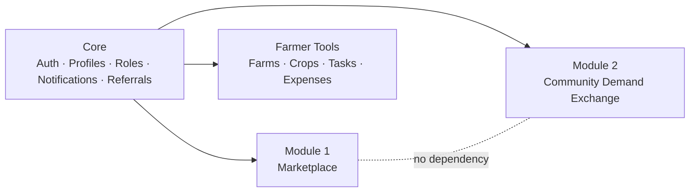

# Farmora: Product Requirements Document (PRD)

> **"Families Decide. Farmers Grow. Everyone Benefits."**

| | |
|---|---|
| Version | 1.0 (Zero-cost MVP) |
| Date | 11 Oct 2026 |
| Stack | Next.js + React + TypeScript + Tailwind · Supabase (PostgreSQL, Auth, Storage) · Vercel · GitHub · Google Analytics |
| Covers | Deliverables 1 (PRD), 4 (MVP feature list), 5 (user stories) |

---

## 1. Problem

| Who | Pain |
|---|---|
| **Farmers** | Grow based on guesswork or last year's mandi price → gluts, distress sales, low income. No direct line to the people who eat their food |
| **Families** | Can't find trustworthy, traceable, chemical-free staples (millets, ghee, honey, cold-pressed oils). No way to tell farmers what they want |
| **Market** | Demand signals reach farmers months too late, through many middlemen |

## 2. Solution

Farmora connects the two ends of the food chain:

1. **Community Demand Exchange (Module 2):** families vote, request and answer polls about what they want to eat next season. Farmers see aggregated demand **before they sow**.
2. **Farmer tools:** simple farm and crop management, harvest announcements, demand insights.
3. **Direct marketplace (Module 1):** farmers sell farm products (honey, ghee, oils, millets, pulses, spices) directly to families.

## 3. Goals & Success Metrics (first 6 months)

| Goal | Metric | Target |
|---|---|---|
| Families express demand | Families who voted at least once | 10,000 |
| Signal quality | Avg votes per active family per cycle | ≥ 5 |
| Farmers use demand data | Farmers opening Demand Dashboard monthly | 60% of farmers |
| Demand → supply | Harvest announcements linked to top-20 voted items | ≥ 50 |
| Marketplace | Monthly orders | 1,000 |
| Cost | Infrastructure spend | **₹0** until 20k MAU |

## 4. Personas

| Persona | Profile | Needs |
|---|---|---|
| **Lakshmi (family)** | 34, Hyderabad, mother of two, Telugu/English, buys groceries on phone | Healthy, trustworthy food; a voice in what's grown; simple UI |
| **Ravi (farmer)** | 42, Guntur, 6 acres, Telugu, basic Android phone, WhatsApp user | Know what will sell; better price; very simple, voice/icon-friendly app |
| **Anitha (admin)** | Farmora operations | Moderate requests, run polls, approve farmers/products, see analytics |

## 5. Scope & Modules

### 5.1 Module independence requirement (Module 2)

The Community Demand Exchange **must be completely independent from the Marketplace**:

| Rule | Implementation |
|---|---|
| Separate data | Own Postgres schema `demand`; **no foreign keys** to marketplace tables. Depends only on `public.profiles` / `public.farmer_profiles` (core identity) |
| Separate catalog | `demand.items` is its own list of crops/products, not `public.products` |
| Separate code | `src/features/demand/*`, routes under `/demand/*`, own API functions (`demand.*` RPCs) |
| Separate failure domain | Demand pages never query marketplace tables; marketplace pages never query `demand.*` |
| Feature flags | `NEXT_PUBLIC_FEATURE_MARKETPLACE` and `NEXT_PUBLIC_FEATURE_DEMAND` toggle each module independently |
| No money | Votes, requests, polls and pre-order *interest* are **non-binding and free**. No payment flows in Module 2 |

---

## 6. Functional Requirements

Priority: **P0** = MVP must-have (90 days) · **P1** = MVP if time allows · **P2** = post-MVP

### 6.1 Core
| ID | Requirement | P |
|---|---|---|
| C-1 | Sign up / log in with **Google** | P0 |
| C-2 | Sign up / log in with **Email OTP** (6-digit code) | P0 |
| C-3 | Choose role on onboarding: Family or Farmer (admin assigned manually) | P0 |
| C-4 | Profile: name, language, state, district, pincode | P0 |
| C-5 | Language switch: English, తెలుగు, தமிழ், हिन्दी | P0 |
| C-6 | In-app notifications | P0 |
| C-7 | Referral link (`?ref=CODE`) + points on referee's first order | P1 |
| C-8 | Installable PWA (home-screen icon, offline shell) | P1 |
| C-9 | Google Analytics with cookie consent | P0 |

### 6.2 Module 2: Community Demand Exchange

**Families**
| ID | Requirement | P |
|---|---|---|
| D-1 | **Vote for crops** they want farmers to grow (current season cycle) | P0 |
| D-2 | **Vote for products** they want to buy | P0 |
| D-3 | Optional "how much per month" with each vote (kg / litre / piece / dozen) | P0 |
| D-4 | Max **10 votes per family per season**, so every vote counts; can change votes during the cycle | P0 |
| D-5 | **Submit crop request** (not in list) | P0 |
| D-6 | **Submit product request** | P0 |
| D-7 | Track status of my requests (pending / approved / merged / rejected) | P0 |
| D-8 | **Participate in polls & surveys** (single, multi-choice, rating, text) | P0 |
| D-9 | See poll results (if public) | P0 |
| D-10 | **See trending crops/products** (leaderboard + "rising this week") | P0 |
| D-11 | Filter leaderboard by my district / state | P0 |
| D-12 | **See upcoming harvests** from farmers | P0 |
| D-13 | Mark non-binding **pre-order interest** in an upcoming harvest | P0 |
| D-14 | Share an item/poll on WhatsApp ("Vote for Foxtail Millet!") | P1 |

**Farmers**
| ID | Requirement | P |
|---|---|---|
| D-20 | **Demand Dashboard** overview | P0 |
| D-21 | **Most requested crops** | P0 |
| D-22 | **Most requested products** | P0 |
| D-23 | **Demand by region** (state → district; regions with < 3 voters hidden) | P0 |
| D-24 | **Seasonal demand trends** (monthly + by season cycle) | P0 |
| D-25 | **Consumer interest report** per item (votes, qty, requests, regions, trend) | P0 |
| D-26 | Announce **upcoming harvest** | P0 |
| D-27 | **Pre-order interest report** per harvest (families, quantity, districts) | P0 |
| D-28 | Download reports as CSV | P1 |

**Admins**
| ID | Requirement | P |
|---|---|---|
| D-40 | **Create polls** (draft → active → closed), multi-language, region-targeted | P0 |
| D-41 | **Manage polls** (edit drafts, close, hide results) | P0 |
| D-42 | **Approve requests**: approve as new item / merge into existing / reject with note | P0 |
| D-43 | Manage demand items & season cycles | P0 |
| D-44 | **Demand analytics** (participation, votes, requests, polls, harvests) | P0 |
| D-45 | **Reports** (CSV export of leaderboard, regions, poll results) | P1 |

### 6.3 Module 1: Marketplace (lean MVP)
| ID | Requirement | P |
|---|---|---|
| M-1 | Categories: Honey, Ghee, Oils, Millets, Pulses, Spices | P0 |
| M-2 | Farmer: create product + variants (size, MRP, price, stock) + images; admin approval | P0 |
| M-3 | Browse, search, filter (category, price, organic) | P0 |
| M-4 | Product page with farmer story, reviews | P0 |
| M-5 | Cart, wishlist, addresses | P0 |
| M-6 | Checkout with **Razorpay** (UPI, cards, netbanking); stock reserved for 20 min | P0 |
| M-7 | Order tracking (confirmed → packed → shipped → delivered) | P0 |
| M-8 | Farmer order management + tracking number | P0 |
| M-9 | Verified-purchase reviews & ratings | P1 |
| M-10 | Coupons, subscriptions | P2 |

### 6.4 Farmer Tools
| ID | Requirement | P |
|---|---|---|
| F-1 | Farmer profile (public storefront) | P0 |
| F-2 | Farms (location, acres, soil, water) | P0 |
| F-3 | Crops with sowing / expected harvest dates, photos | P0 |
| F-4 | Fertilizer & irrigation task list with due dates | P1 |
| F-5 | Expense tracking | P1 |
| F-6 | Weather (district) and mandi price widgets | P1 |

### 6.5 Admin (general)
| ID | Requirement | P |
|---|---|---|
| A-1 | Verify farmers | P0 |
| A-2 | Approve / reject products | P0 |
| A-3 | View / update / cancel orders | P0 |
| A-4 | User list & search | P0 |
| A-5 | Sales, revenue and inventory overview | P1 |

---

## 7. Long-Term Features (post-MVP)

| Feature | Zero/low-cost approach first | Upgrade path |
|---|---|---|
| **AI Crop Recommendation** | Rules: demand rank × season × district × farmer's soil → top 5 crops | ML model trained on demand + yield + price history |
| **AI Demand Forecasting** | SQL moving averages + seasonal comparison (`get_seasonal_trends`) | Prophet / LightGBM in a scheduled GitHub Action writing forecasts back to Postgres |
| **AI Disease Detection** | On-device TensorFlow.js model (PlantVillage-trained) in the browser: free and private | Server model (see [docs/01-architecture.md](../01-architecture.md)) |
| **AI Yield Prediction** | Area × crop average × health factor | ML with weather + soil data |
| **Weather Updates** | OpenWeatherMap free tier, cached per district in `weather_cache` | Paid tier / IMD data |
| **Market Price Trends** | data.gov.in (Agmarknet) API, daily job into `market_prices` | Same, with more markets |
| **WhatsApp Notifications** | `wa.me` share links + free WhatsApp Channel | WhatsApp Cloud API templates (paid per conversation) |
| **Referral System** | Built into `profiles.referral_code` + `points_ledger` (MVP P1) | Wallet credits, tiers |
| **Loyalty Rewards** | `points_ledger` for orders, votes, approved requests | Redeemable coupons, badges |
| **Farmer Community** | See [docs/10-community.md](../10-community.md) | Full social network |

---

## 8. Non-Functional Requirements

| Area | Requirement |
|---|---|
| **Mobile-first** | Designed at 360 px first; touch targets ≥ 44 px; works on 3G (≤ 200 KB JS on first load for demand pages) |
| **Simple for farmers** | Icon + text labels, max 1 primary action per screen, native-language first, large fonts option |
| **Performance** | LCP < 2.5 s on 4G mid-range Android; leaderboard served from materialised view |
| **Scale** | 0 → 100,000+ users without re-architecture (see scaling plan) |
| **Security** | Supabase RLS on every table; privileged writes only through `security definer` functions; server-only service-role key; Razorpay signature verification; OWASP Top 10 reviewed |
| **Privacy** | DPDP Act 2023: explicit consent, data export & delete; demand data shown only as aggregates; regions with < 3 voters hidden; no ads to children |
| **Accessibility** | WCAG 2.1 AA |
| **i18n** | All UI strings in 4 locales; content translations in `*_i18n` jsonb |
| **Availability** | Best-effort on free tier; status page via UptimeRobot |
| **Cost** | ₹0/month infrastructure until free-tier limits (see architecture) |

---

## 9. MVP Feature List (Deliverable 4)

### In MVP (90 days)
- ✅ Landing page with live demand stats and tagline
- ✅ Google + Email OTP login, role onboarding, profile & language
- ✅ **Demand Exchange:** vote (crops & products), requests, polls, trending, leaderboard by region, upcoming harvests, pre-order interest
- ✅ **Farmer Demand Dashboard:** most requested, by region, seasonal trends, interest & pre-order reports
- ✅ **Admin Demand Console:** polls, request moderation, items & cycles, analytics
- ✅ Farmer profile, farms, crops (dates, photos), harvest announcements
- ✅ Marketplace lean: catalog, variants & stock, cart, wishlist, Razorpay checkout, order tracking, farmer fulfilment, admin approval
- ✅ In-app notifications, PWA, Google Analytics, 4 languages

### Not in MVP
- ❌ Native mobile apps (PWA instead)
- ❌ Coupons, subscriptions, wallet redemption
- ❌ SMS / paid WhatsApp notifications
- ❌ AI models (rules-based recommendations only)
- ❌ Social network, equipment rental, loans, insurance

---

## 10. User Stories (Deliverable 5)

Format: *As a … I want … so that …* + acceptance criteria (AC).

### Families
| ID | Story | Acceptance criteria |
|---|---|---|
| US-F1 | As a family, I want to log in with Google or an email code so that I don't need a password | AC1 Google button signs me in. AC2 Entering email sends a 6-digit code valid 1 h. AC3 Wrong code shows an error; 5 wrong attempts are rate-limited |
| US-F2 | As a family, I want to vote for crops I want grown so that farmers plant what I'll buy | AC1 I see this season's crop list with current vote counts. AC2 Tapping 👍 records my vote instantly (optimistic UI). AC3 Vote count shows "7 of 10 votes left". AC4 11th vote shows "You've used all 10 votes. Remove one to vote again" |
| US-F3 | As a family, I want to say how much I'd buy per month so that farmers can estimate quantity | AC1 Optional qty + unit after voting. AC2 Max 1,000 per item |
| US-F4 | As a family, I want to request a crop that's not listed so that it can be added | AC1 Form: name, type (crop/product), qty, season, organic preference. AC2 Max 5 requests / 24 h. AC3 I see the request in "My requests" as Pending. AC4 I get a notification when it's approved, merged or rejected |
| US-F5 | As a family, I want to answer a poll so that my opinion counts | AC1 Only active polls for my region show. AC2 Required questions are enforced. AC3 One response per poll. AC4 After submitting I see results if public |
| US-F6 | As a family, I want to see trending crops so that I know what others want | AC1 Leaderboard (this season) + "Rising this week". AC2 Filter by my district/state. AC3 Shown in my language |
| US-F7 | As a family, I want to see upcoming harvests and say I'm interested so that I can get fresh produce | AC1 List sorted by harvest date with farm name and verified badge. AC2 "I'm interested" with qty; I can change or withdraw. AC3 Clearly labelled "non-binding, no payment" |
| US-F8 | As a family, I want to buy ghee from a farmer and pay by UPI so that I get it home | AC1 Add to cart → address → Razorpay → confirmation. AC2 Out-of-stock blocks checkout with a clear message. AC3 Unpaid orders auto-expire in 20 min and stock is released |
| US-F9 | As a family, I want to track my order so that I know when it arrives | AC1 Timeline of statuses with dates. AC2 Tracking number when shipped. AC3 Notification on each change |

### Farmers
| ID | Story | Acceptance criteria |
|---|---|---|
| US-R1 | As a farmer, I want to see the most voted crops in my district so that I decide what to sow | AC1 Demand Dashboard shows top 10 crops for selected district/state, with votes and monthly kg. AC2 Updated at least every 10 min. AC3 Works in Telugu |
| US-R2 | As a farmer, I want to see demand by region for a crop so that I know where to sell | AC1 Table + bar chart by state/district. AC2 Regions with < 3 voters hidden |
| US-R3 | As a farmer, I want seasonal trends so that I can plan next season | AC1 12-month chart of votes, requests and pre-order interest. AC2 Comparison across Kharif / Rabi / Zaid cycles |
| US-R4 | As a farmer, I want to see most requested crops & products so that I find unmet demand | AC1 Ranked list with request count, total monthly kg, % wanting organic |
| US-R5 | As a farmer, I want to announce my upcoming harvest so that families can show interest early | AC1 Form: crop (from demand list or free text), date, quantity, indicative price, photo. AC2 Appears in Upcoming Harvests immediately |
| US-R6 | As a farmer, I want a pre-order interest report so that I know how much to keep aside | AC1 Per harvest: families, total qty, by district. AC2 No personal data of families shown |
| US-R7 | As a farmer, I want to list my honey with 250 g and 500 g sizes so that families can buy | AC1 Product → pending approval. AC2 Variants with MRP/price/stock. AC3 Low stock warning at threshold |
| US-R8 | As a farmer, I want to mark orders packed / shipped / delivered so that customers stay informed | AC1 Only forward transitions allowed. AC2 Tracking number on ship. AC3 Customer notified |
| US-R9 | As a farmer, I want to record crops with sowing & harvest dates so that I track my farm | AC1 Add farm → add crop → dates validated (harvest ≥ sowing) |

### Admins
| ID | Story | Acceptance criteria |
|---|---|---|
| US-A1 | As an admin, I want to create a poll in 4 languages so that every family can answer | AC1 Draft with questions (single/multi/rating/text). AC2 Optional state/district targeting. AC3 Publish → visible; questions locked after publish |
| US-A2 | As an admin, I want to review requests so that the list stays clean | AC1 Queue of pending requests with similar-item suggestions. AC2 Approve (creates item), Merge (pick item), Reject (note). AC3 Requester notified |
| US-A3 | As an admin, I want demand analytics so that I can report to partners | AC1 Families voted, votes (7 d), pending requests, poll responses, harvests, pre-order families. AC2 CSV export |
| US-A4 | As an admin, I want to start a new season cycle so that voting resets each season | AC1 Only one current cycle. AC2 Previous cycle data retained for trends |
| US-A5 | As an admin, I want to verify farmers and approve products so that families can trust listings | AC1 Verified badge shown publicly. AC2 Rejected product shows reason to farmer |
