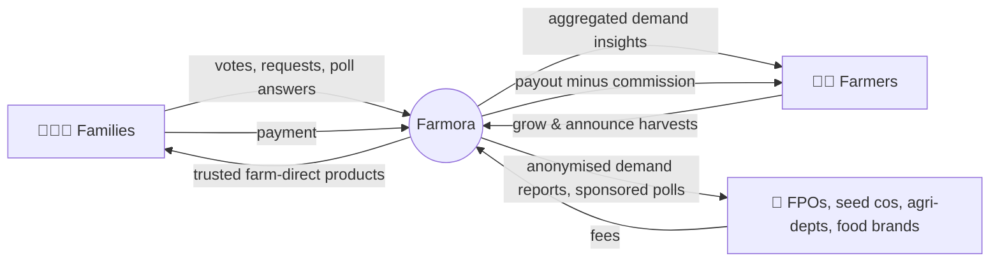
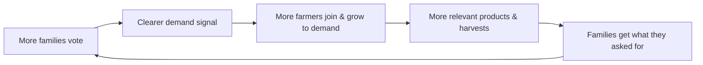

# Farmora: Startup Business Model & Revenue Model

Covers deliverables 2 (Startup Business Model) and 19 (Revenue Model).

## 1. Lean Canvas

| Block | Farmora |
|---|---|
| **Problem** | 1) Farmers sow without knowing demand → gluts and low prices. 2) Families can't find trustworthy farm-direct staples. 3) Demand signals pass through many middlemen |
| **Customer segments** | Urban & semi-urban health-conscious families (Tier 1–2 cities, South India first); small and marginal farmers, FPOs, SHGs |
| **Unique value proposition** | **"Families Decide. Farmers Grow. Everyone Benefits."** The only platform where families shape what's grown *before* sowing, then buy it direct |
| **Solution** | Community Demand Exchange (votes, requests, polls, harvest interest) + farmer demand dashboard + direct marketplace |
| **Channels** | WhatsApp communities, Instagram/YouTube reels, apartment associations, FPOs, KVKs, village ambassadors, referrals |
| **Revenue streams** | Marketplace commission, farmer Pro plan, sponsored polls & insight reports, delivery fees, (later) premium services |
| **Cost structure** | ₹0 infra at start (free tiers); founders' time; later: Supabase/Vercel paid tiers, payment gateway fees, field outreach, packaging/logistics |
| **Key metrics** | Families voting per cycle, votes per family, farmers using dashboard, harvests linked to top demand, orders, repeat rate, GMV |
| **Unfair advantage** | Proprietary, season-by-season **demand dataset** by district that no mandi or e-commerce site has; community trust and network effects |

## 2. Value Exchange

## 3. Network Effects & Flywheel

Cold start: launch demand voting **first** (free, no supply needed). A large family base and visible demand then attracts farmers before the marketplace has much stock.

## 4. Go-to-Market Phases

| Phase | Months | Focus |
|---|---|---|
| **Seed** | 0–3 | Hyderabad + Guntur/Vijayawada; 50 founding farmers; 5,000 voting families; MVP marketplace |
| **Prove** | 4–9 | Add Chennai, Coimbatore, Bengaluru; 500 farmers; 50,000 families; first B2B demand report |
| **Scale** | 10–24 | Pan-South India + Hindi metros; FPO partnerships; 100,000+ families |

---

## 5. Revenue Model (Deliverable 19)

### 5.1 Revenue Streams

| # | Stream | Who pays | Pricing (indicative) | Starts |
|---|---|---|---|---|
| 1 | **Marketplace commission** | Farmer (deducted from payout) | 8% (first 3 months 0% for founding farmers) | Day 61–90 |
| 2 | **Delivery fee** | Family | ₹49 below ₹499 order value; free above | Day 61–90 |
| 3 | **Farmora Pro for farmers** | Farmer / FPO | ₹99/month or ₹999/year: district-level drill-down, 12-month trends, CSV export, early access to new polls, priority listing | Month 4 |
| 4 | **Sponsored polls & surveys** | FPOs, seed companies, food brands, agri-departments, researchers | ₹5,000–₹50,000 per poll (clearly labelled "Sponsored") | Month 4 |
| 5 | **Demand insight reports** | Agri-businesses, state agriculture departments, NGOs, investors | ₹10,000–₹1,00,000 per quarterly report (**aggregated & anonymised only**) | Month 6 |
| 6 | **Pre-harvest booking facilitation** | Farmer (on converted pre-orders) | 3% on harvest orders that came from pre-order interest | Month 6 |
| 7 | **Featured listings** | Farmer / brand | ₹199–₹999 per week | Month 6 |
| 8 | **Grants & CSR** | Govt programmes, foundations, CSR funds | Non-dilutive, project-based | Ongoing |
| 9 | **Later** | Equipment rental, soil testing, insurance/loan referrals (see [docs/09](../09-future-expansion.md)) | Commissions | Year 2 |

> **Data ethics:** we never sell personal data. B2B products contain only aggregated, region-level numbers (minimum group size of 3, typically far larger), as stated in the privacy policy.

### 5.2 Unit Economics (per marketplace order, illustrative)

| Item | ₹ |
|---|---|
| Average order value (AOV) | 650 |
| Commission (8%) | 52 |
| Delivery fee collected (avg) | 15 |
| Payment gateway fee (~2% of AOV) | −13 |
| Packaging subsidy / support | −10 |
| **Contribution per order** | **≈ 44** |

Logistics is farmer-shipped (India Post / courier partner) in the MVP, so Farmora carries no inventory or warehouse cost.

### 5.3 Revenue Projection (conservative)

| Month | Families | Farmers | Orders/mo | GMV/mo | Commission | Pro subs | B2B (polls/reports) | **Monthly revenue** |
|---|---|---|---|---|---|---|---|---|
| 3 | 5,000 | 50 | 300 | ₹1.95 L | ₹0 (waived) | 0 | 0 | **≈ ₹4.5k** (delivery fees) |
| 6 | 20,000 | 200 | 1,500 | ₹9.75 L | ₹78k | ₹5k | ₹25k | **≈ ₹1.3 L** |
| 12 | 100,000 | 1,000 | 8,000 | ₹52 L | ₹4.2 L | ₹30k | ₹1.5 L | **≈ ₹7.2 L** |

Monthly revenue includes delivery fees of about ₹15 per order.

### 5.4 Cost Structure

| Stage | Monthly infra cost | Notes |
|---|---|---|
| 0 – ~20k MAU | **₹0** | Supabase Free, Vercel Hobby (see licence note in architecture), GitHub Free, GA4 |
| ~20k – 100k MAU | ≈ $45 (≈ ₹3,800) | Supabase Pro $25 + Vercel Pro $20 (or Cloudflare free) |
| 100k+ MAU | $100–$400 | Supabase compute add-ons, CDN for images, paid email |

Infrastructure stays **under 1% of revenue** at every stage in the projection above.

### 5.5 Pricing Principles
- Families **never pay** to vote, request or answer polls.
- Farmers get demand insights **free** at state level; Pro adds depth, not basic access.
- Commission only on successful sales; nothing up front.
- Sponsored content is always labelled; sponsors cannot see individual responses.

## 6. Competitive Positioning

| | Mandis / traders | Quick-commerce apps | Organic D2C brands | **Farmora** |
|---|---|---|---|---|
| Families influence what's grown | ❌ | ❌ | ❌ | ✅ |
| Farmer sees demand before sowing | ❌ | ❌ | ❌ | ✅ |
| Direct farmer → family | ❌ | ❌ | Partial | ✅ |
| Farmer's name & story on product | ❌ | ❌ | Partial | ✅ |
| Regional-language first | Partial | ❌ | ❌ | ✅ |

## 7. Key Risks

| Risk | Mitigation |
|---|---|
| Votes don't convert to purchases | Track vote → pre-order → order funnel; quantity per vote; limited votes per family |
| Fake / bot voting | Verified email/Google accounts, 10 votes per cycle, rate limits, anomaly checks by admin |
| Farmers lack smartphone skills | Ambassadors, voice/icon UI, WhatsApp share of dashboard screenshots |
| Free-tier limits hit early | Upgrade triggers defined; costs covered by revenue by then |
| Logistics quality | Start with non-perishables (honey, ghee, oils, millets, pulses, spices); packaging guidelines |
