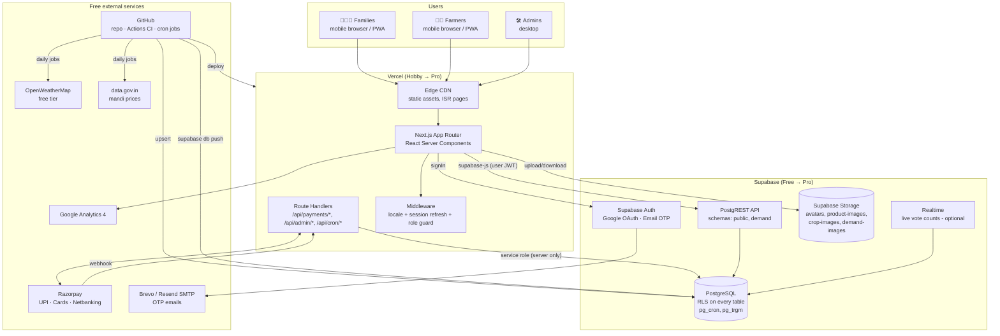
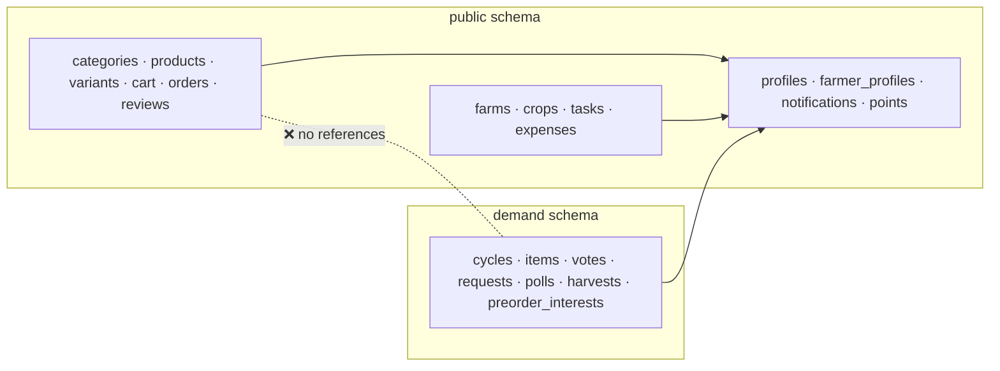
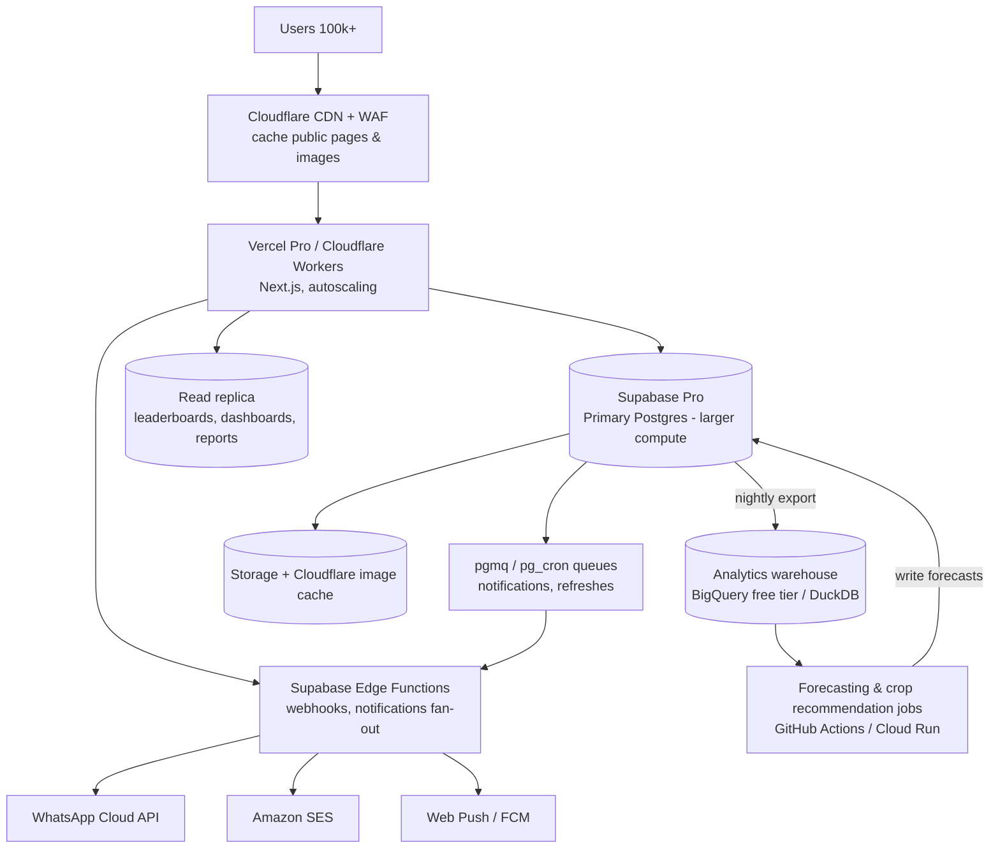

# Farmora MVP: System Architecture, Zero-Cost Stack & Scaling

Covers deliverables 3 (System Architecture Diagram), the **Zero-Cost Requirement** (free hosting, database, storage, auth, deployment) and 20 (Future Scaling Architecture).

> Free-tier limits below are as published at the time of writing. **Check each provider's pricing page before launch**, because limits change.

## 1. System Architecture

### 1.1 Request paths

| Path | How |
|---|---|
| **Read public data** (leaderboard, products, harvests) | Server Component → `supabase-js` with anon key → PostgREST → RLS / `security definer` RPC → cached with `revalidate: 60` |
| **User writes** (vote, request, cart, crop) | Client/Server Action → `supabase-js` with user JWT → RLS enforces ownership and column-level grants |
| **Privileged writes** (create order, confirm payment) | Route Handler → service-role client (server only) → `create_pending_order()` / `confirm_order_payment()` |
| **Admin actions** | Admin UI → RPCs that check `is_admin()` (e.g. `demand.admin_review_request`) |
| **Background jobs** | `pg_cron` inside Postgres (expire unpaid orders every 5 min, refresh demand stats every 10 min) + GitHub Actions schedule (weather, mandi prices, backups) |

### 1.2 Module isolation

The Demand Exchange can be switched off (`NEXT_PUBLIC_FEATURE_DEMAND=false`), or moved to its own Supabase project later, without touching the marketplace.

### 1.3 Security model

| Layer | Control |
|---|---|
| Auth | Supabase Auth JWT (1 h) + refresh token in httpOnly cookies via `@supabase/ssr` |
| Data | RLS on **every** table; explicit `grant`s; column-level grants block clients from writing `status`, `role`, `reserved_qty`, prices on orders, etc. |
| Privileged logic | `security definer` functions with `set search_path = ''`, executable only by the roles that need them |
| Secrets | `SUPABASE_SERVICE_ROLE_KEY`, `RAZORPAY_KEY_SECRET` and `RAZORPAY_WEBHOOK_SECRET` live only in Vercel server env vars (never `NEXT_PUBLIC_*`) |
| Payments | Amount computed in DB; Razorpay signature (HMAC-SHA256) verified on server; webhook signature verified; idempotent confirmation |
| Abuse | 10 votes/cycle, 5 requests/day, one poll response per user, Supabase Auth rate limits, Vercel/Cloudflare bot protection |
| Uploads | Bucket MIME + size limits; path must start with the user's id |
| Headers | CSP, HSTS, X-Frame-Options, Referrer-Policy via `next.config` |
| Privacy | Aggregates only for demand insights; min group size 3; DPDP consent + delete-my-account |

---

## 2. Zero-Cost Architecture

### 2.1 Free hosting architecture

| Need | Service | Free allowance (verify) | Notes |
|---|---|---|---|
| Web app + API routes | **Vercel Hobby** | ~100 GB bandwidth/mo, serverless functions, preview deployments | ⚠️ **Vercel Hobby is for personal, non-commercial use.** Use it for build + private beta. Before charging customers, either upgrade to **Vercel Pro ($20/mo)** or move to **Cloudflare Workers/Pages (free tier allows commercial use)** via `@opennextjs/cloudflare`. The code stays the same |
| Domain | `farmora.vercel.app` | Free subdomain | A custom `.in` domain (~₹700/yr) is the only optional early cost |
| Images | Serve pre-compressed WebP straight from Supabase Storage public URLs | | Set `images.unoptimized = true` (or a custom loader) to avoid Vercel image-optimisation quotas |
| Uptime monitoring | UptimeRobot | 50 monitors, 5-min checks | |
| Error tracking | Sentry Developer | ~5k errors/mo | |

### 2.2 Free database architecture

| Need | Service | Free allowance (verify) |
|---|---|---|
| PostgreSQL | **Supabase Free** | 500 MB database, shared CPU, 2 projects |
| REST API | PostgREST (built-in) | Included |
| Realtime | Supabase Realtime | ~200 concurrent connections |
| Scheduled SQL | `pg_cron` | Included |
| Backups | ❗ Not included on free | **Nightly `pg_dump` via GitHub Actions**, encrypted with `age`, stored as a private artifact (90-day retention) |
| Inactivity | Free projects pause after ~7 days without activity | Real traffic keeps it active. A daily GitHub Actions health check also prevents pausing during development |

**Keeping under 500 MB:** narrow tables, demand counts pre-aggregated in a materialised view, images in Storage (not DB), notifications pruned after 90 days. Rough size per 10k active families: ~25–40 MB.

### 2.3 Free storage architecture

| Need | Service | Free allowance (verify) |
|---|---|---|
| Files | **Supabase Storage** | 1 GB storage, ~5 GB egress/mo |
| Optimisation | Client-side compression to WebP ≤ 200 KB (`browser-image-compression`) before upload | Image transformations are a paid feature, so resize on the device |
| Buckets | `avatars` (public), `product-images` (public), `demand-images` (public), `crop-images` (private, signed URLs) | |

1 GB holds about 5,000 product and crop photos at 200 KB each.

### 2.4 Free authentication architecture

| Need | Service | Free allowance (verify) |
|---|---|---|
| Users | **Supabase Auth** | 50,000 monthly active users |
| Google Login | Google Cloud OAuth client | Free, unlimited |
| Email OTP | Supabase Auth `signInWithOtp({ email })` with `{{ .Token }}` template | ⚠️ Built-in mailer is heavily rate-limited (a few emails per hour) and **not for production** |
| SMTP for OTP | **Brevo** (~300 emails/day free) or **Resend** (~3,000/mo, 100/day free) | Plug in as custom SMTP in Supabase Auth settings |

Push **Google login as the primary button**: it is unlimited and free. Email OTP is the fallback. When daily OTP volume nears the SMTP limit, move to Amazon SES (~$0.10 per 1,000 emails).

### 2.5 Free deployment plan

| Step | Tool | Cost |
|---|---|---|
| Source control | GitHub Free (private repo) | ₹0 |
| CI (lint, typecheck, test, build) | GitHub Actions (2,000 min/mo on private repos) | ₹0 |
| DB migrations | `supabase db push` in GitHub Actions on `main` | ₹0 |
| Preview environments | Vercel preview per PR | ₹0 |
| Production deploy | Vercel Git integration on `main` | ₹0 |
| Scheduled jobs | GitHub Actions `schedule:` (weather, mandi prices, backup) + `pg_cron` | ₹0 |
| Analytics | Google Analytics 4 | ₹0 |
| Payments | Razorpay: no setup or annual fee; ~2% per successful transaction | ₹0 upfront |

**Total fixed monthly cost at launch: ₹0.**

---

## 3. Capacity Plan (0 → 100,000+ users)

| Stage | Users | What runs | Monthly cost | Upgrade trigger |
|---|---|---|---|---|
| **0. Build** | 0–500 | Supabase Free, Vercel Hobby, GitHub, GA4 | ₹0 | Start of commercial sales → Vercel Pro or Cloudflare |
| **1. Launch** | 500–20k | Same + Brevo/Resend SMTP + Cloudflare/Vercel | ₹0–1,700 | DB > 400 MB, egress > 4 GB, MAU > 40k, or need for daily backups |
| **2. Growth** | 20k–100k | **Supabase Pro** ($25: 8 GB DB, 100k MAU, 250 GB egress, daily backups) + Vercel Pro ($20) | ≈ ₹3,800 | p95 API > 500 ms, CPU > 70% sustained |
| **3. Scale** | 100k–500k | Supabase Pro + larger compute add-on + **read replica**; Cloudflare CDN in front of Storage images; SES for email | ₹10k–35k | Write contention, complex jobs, team > 10 engineers |
| **4. Enterprise** | 500k+ | Move to the AWS architecture in [docs/01-architecture.md](../01-architecture.md) (ECS + RDS + Redis), or Supabase Team/Enterprise | Revenue-funded | |

## 4. Future Scaling Architecture (Deliverable 20)

### Scaling techniques, in order of use
1. **Cache aggressively:** public demand pages use ISR (`revalidate: 60`); leaderboard comes from a materialised view; CDN caches product images.
2. **Pre-aggregate:** `demand.mv_item_votes` refreshed every 10 min; add daily rollups as data grows.
3. **Indexes & partitioning:** partition `demand.votes` by `cycle_id` when it passes ~10M rows; partition `notifications` by month.
4. **Read replica:** route dashboards and reports to a replica.
5. **Queues:** move notifications and heavy jobs to `pgmq` + Edge Functions.
6. **Split modules:** the `demand` schema has no marketplace dependencies, so it can move to its own database or service if needed.
7. **Native apps:** wrap the PWA with Capacitor, or build React Native apps, sharing TypeScript types and the Supabase client.
8. **Exit path:** standard Postgres + SQL migrations. `pg_dump` → RDS works, and auth users can be exported. No lock-in on business data.
