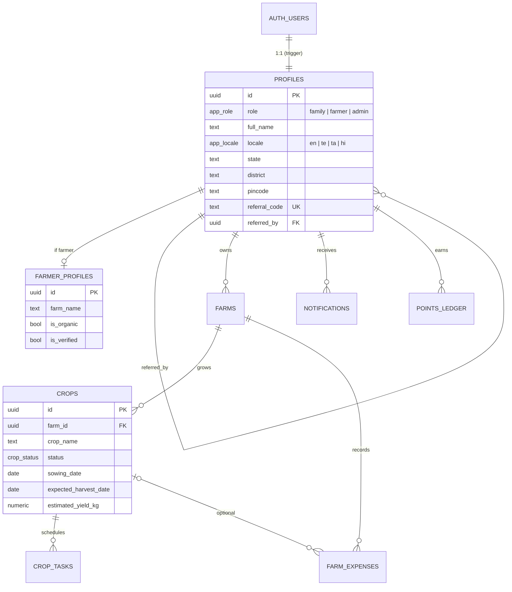
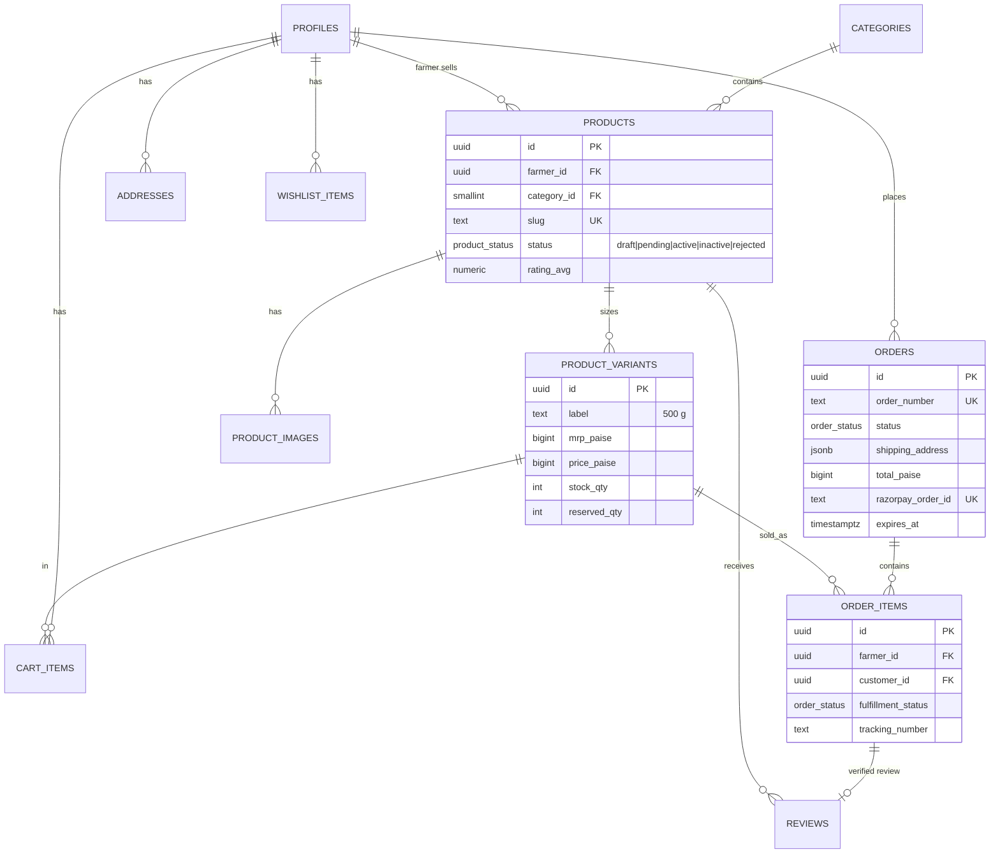
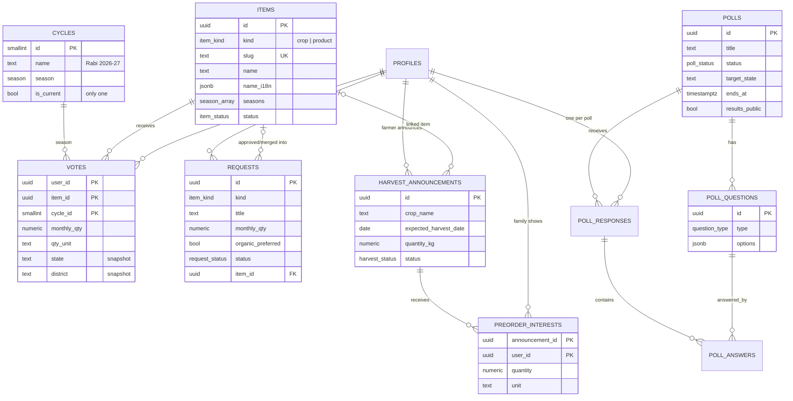

# Farmora MVP: Database Schema & Entity Relationship Diagram

Covers deliverables 6 (Database Schema) and 7 (ERD).

**Source of truth:** the SQL migrations in [supabase/migrations](../../supabase/migrations), plus [supabase/seed.sql](../../supabase/seed.sql).

| Migration | Contents |
|---|---|
| [20261011000001_core.sql](../../supabase/migrations/20261011000001_core.sql) | Enums, `profiles` (auto-created on sign-up), roles, farmer profile, farms, crops, tasks, expenses, notifications, points, weather/mandi caches, admin helpers |
| [20261011000002_marketplace.sql](../../supabase/migrations/20261011000002_marketplace.sql) | Categories, products, variants, images, addresses, cart, wishlist, orders, order items, payment events, reviews, order workflow functions, `pg_cron` expiry |
| [20261011000003_demand_exchange.sql](../../supabase/migrations/20261011000003_demand_exchange.sql) | **Module 2** in its own `demand` schema: cycles, items, votes, requests, polls, questions, responses, answers, harvest announcements, pre-order interest, materialised stats, RPCs |
| [20261011000004_storage.sql](../../supabase/migrations/20261011000004_storage.sql) | Storage buckets + policies |

> [database/schema.sql](../../database/schema.sql) is the **scale-stage** schema for the AWS architecture (self-managed auth). Use it only when migrating off Supabase (see Stage 4 of the scaling plan).

## 1. Conventions
- `uuid` primary keys (`gen_random_uuid()`); identity integers for lookup tables.
- Money in **paise** (`bigint`).
- Translations in `*_i18n jsonb` (`{"te": "...", "ta": "...", "hi": "..."}`), with English in the base column.
- Ownership columns default to `auth.uid()`, so clients never send their own user id.
- **RLS on every table.** Clients may only write the columns granted explicitly. Status changes, prices on orders and stock reservations go through `security definer` functions.

## 2. Entity Relationship Diagram

### 2.1 Core + Farmer tools

### 2.2 Module 1: Marketplace

### 2.3 Module 2: Community Demand Exchange (`demand` schema)

Note: `PROFILES` is the only table shared with the rest of the system. **There are no relationships between the `demand` schema and marketplace tables.**

## 3. Table Reference

### Core (`public`)
| Table | Purpose | Client access |
|---|---|---|
| `profiles` | Role, name, language, region, referral code | Read/update own (limited columns); role via `set_my_role()` |
| `farmer_profiles` | Public farmer storefront, verified badge | Public read; farmer updates own; verify via `admin_verify_farmer()` |
| `farms`, `crops`, `crop_tasks`, `farm_expenses` | Farmer tools | Farmer owns; admin read |
| `notifications` | In-app inbox | Read own, mark read |
| `points_ledger` | Referral and loyalty points | Read own |
| `market_prices`, `weather_cache` | Data from scheduled jobs | Public read |

### Marketplace (`public`)
| Table | Purpose | Client access |
|---|---|---|
| `categories` | Honey, Ghee, Oils, Millets, Pulses, Spices | Public read; admin write |
| `products`, `product_variants`, `product_images` | Catalog, pricing, stock | Public reads active items; farmer edits own content; status via RPC |
| `addresses`, `cart_items`, `wishlist_items` | Customer state | Owner |
| `orders`, `order_items` | Orders | Read-only (customer / farmer / admin); writes via functions |
| `payment_events` | Webhook idempotency | Service role only |
| `reviews` | Verified-purchase reviews | Public read; write only after delivery |

### Demand Exchange (`demand`)
| Table | Purpose | Client access |
|---|---|---|
| `cycles` | Season voting windows | Public read; admin write |
| `items` | Crops/products open for voting | Public read; admin write |
| `votes` | Family votes (max 10/cycle) + monthly qty | Family: insert/update/delete own; aggregates via RPC |
| `requests` | Crop/product requests | Family insert (5/day); own + admin read; review via RPC |
| `polls`, `poll_questions` | Admin polls & surveys | Public read when published; admin write (questions locked after publish) |
| `poll_responses`, `poll_answers` | Answers | Written only via `submit_poll_response()`; own read |
| `harvest_announcements` | Upcoming harvests | Public read; farmer owns |
| `preorder_interests` | Non-binding interest | Family owns; farmers see aggregates via RPC |
| `mv_item_votes` | Materialised aggregates | Not directly accessible; via RPCs |

## 4. Key Database Functions

| Function | Caller | Purpose |
|---|---|---|
| `public.set_my_role(role)` | user | Onboarding: family ↔ farmer |
| `public.create_pending_order(customer, address)` | server (service role) | Lock stock, compute totals, reserve |
| `public.confirm_order_payment(rzp_order, rzp_payment, method)` | server | Idempotent payment confirmation, stock decrement, referral points, notifications |
| `public.expire_unpaid_orders()` | pg_cron (5 min) | Release reservations |
| `public.farmer_update_fulfillment(...)` | farmer | packed → shipped → delivered |
| `public.admin_*` | admin | Product status, order status, verify farmer, list users |
| `demand.get_leaderboard(...)` | anyone | Top items by votes (filters: kind, state, district, cycle) |
| `demand.get_trending(...)` | anyone | Rising items (last N days vs previous N) |
| `demand.get_upcoming_harvests(...)` | anyone | Harvests + interest counts |
| `demand.get_public_stats()` | anyone | Landing-page counters |
| `demand.get_poll_results(poll)` | anyone (if public) | Option counts, average ratings |
| `demand.submit_poll_response(poll, answers)` | family | Validated, atomic poll submission |
| `demand.get_most_requested(...)` | farmer/admin | Most requested crops/products |
| `demand.get_demand_by_region(...)` | farmer/admin | State/district breakdown (groups below 3 hidden) |
| `demand.get_seasonal_trends(item, months)` | farmer/admin | Monthly votes / requests / pre-orders |
| `demand.get_cycle_history(item)` | farmer/admin | Votes per season |
| `demand.get_preorder_report(announcement?)` | farmer (own) / admin | Families and quantity by district |
| `demand.admin_review_request(...)` | admin | Approve / merge / reject + notify |
| `demand.admin_set_current_cycle(id)` | admin | Switch season |
| `demand.admin_overview()` | admin | Demand KPIs |
| `demand.refresh_stats()` | pg_cron (10 min) | Refresh `mv_item_votes` |
