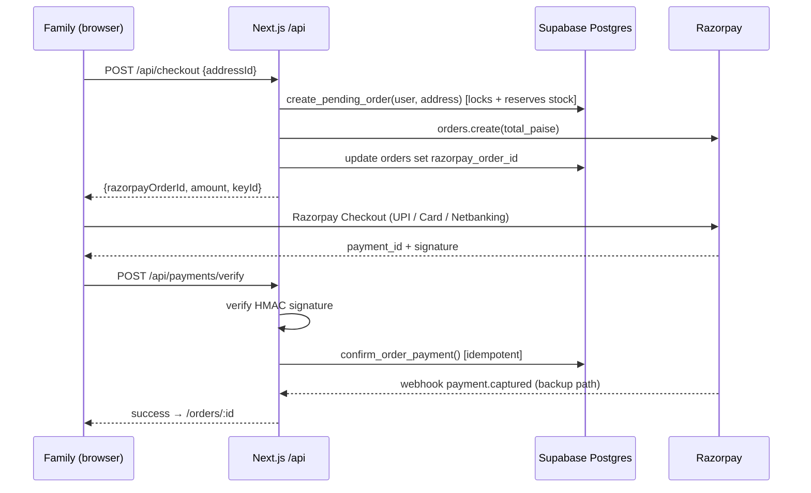

# Farmora MVP: API Design

Covers deliverable 8.

The MVP has **no custom backend server**. The API has three layers:

| Layer | Used for | Auth |
|---|---|---|
| **A. Supabase PostgREST** (auto-generated REST over tables) | Simple reads/writes protected by RLS | User JWT (or anon key for public reads) |
| **B. Postgres RPC functions** (`/rest/v1/rpc/<fn>`) | Aggregates, validation, multi-step logic | User JWT; functions check role internally |
| **C. Next.js Route Handlers** (`/api/*` on Vercel) | Secrets and third parties: Razorpay, admin user bans, cron hooks | Supabase session cookie; service role on server only |

Clients use the typed `supabase-js` SDK (types generated with `supabase gen types typescript`). Demand calls use `supabase.schema('demand')`.

## Conventions
- Base URL (A/B): `https://<project>.supabase.co/rest/v1` · Route handlers (C): `https://<app-domain>/api`
- Headers: `apikey: <anon key>`, `Authorization: Bearer <user JWT>`, `Accept-Profile: demand` for the demand schema
- Pagination: `?limit=20&offset=0` (PostgREST) or `p_limit`/`p_offset` arguments
- Errors: PostgREST errors `{ code, message, details }`. Business errors are raised as stable codes, e.g. `VOTE_LIMIT_REACHED`, `OUT_OF_STOCK:<variant>`, `POLL_NOT_OPEN`. The UI maps codes to translated messages
- Money in paise; dates ISO-8601

---

## 1. Auth (Supabase Auth)

| Action | SDK call |
|---|---|
| Google login | `supabase.auth.signInWithOAuth({ provider: 'google', options: { redirectTo: '<app>/auth/callback' } })` |
| Email OTP: send | `supabase.auth.signInWithOtp({ email, options: { shouldCreateUser: true, data: { role, ref, utm } } })` |
| Email OTP: verify | `supabase.auth.verifyOtp({ email, token, type: 'email' })` |
| Session exchange | `GET /auth/callback?code=…` (Route Handler → `exchangeCodeForSession`) |
| Sign out | `supabase.auth.signOut()` |
| Set role (onboarding) | `rpc('set_my_role', { p_role: 'family' \| 'farmer' })` |

## 2. Profile & Core

| Method | Endpoint | Description |
|---|---|---|
| GET | `/profiles?id=eq.<me>&select=*` | My profile |
| PATCH | `/profiles?id=eq.<me>` | Update name, locale, state, district, pincode, opt-ins |
| GET | `/farmer_profiles?id=eq.<id>` | Public farmer storefront |
| PATCH | `/farmer_profiles?id=eq.<me>` | Edit own storefront |
| GET | `/notifications?order=created_at.desc&limit=20` | Inbox |
| PATCH | `/notifications?id=eq.<id>` `{ read_at }` | Mark read |
| GET | `/points_ledger?select=points.sum()` | Points balance |
| GET | `/market_prices?commodity=eq.Groundnut&state=eq.Andhra Pradesh&order=price_date.desc` | Mandi prices |
| GET | `/weather_cache?state=eq.…&district=eq.…` | Weather |

## 3. Module 2: Community Demand Exchange (`Accept-Profile: demand`)

### Families
| Method | Endpoint | Body / params | Description |
|---|---|---|---|
| GET | `/cycles?is_current=is.true` | | Current season |
| GET | `/items?kind=eq.crop&status=eq.active&order=name` | | Votable crops (or `kind=eq.product`) |
| GET | `/items?name=ilike.*millet*` | | Search items |
| POST | `/rpc/get_leaderboard` | `{ p_kind, p_state, p_district, p_cycle_id, p_limit }` | Ranked items with votes and monthly kg |
| POST | `/rpc/get_trending` | `{ p_kind, p_days: 7, p_limit: 10 }` | Rising this week |
| POST | `/rpc/get_public_stats` | | Families voted, total votes, harvests, polls, farmers |
| GET | `/votes?select=item_id,monthly_qty,qty_unit&cycle_id=eq.<id>` | | My votes (RLS = own) |
| POST | `/votes` | `{ item_id, monthly_qty?, qty_unit? }` | Vote (cycle, region and limit enforced by trigger) |
| PATCH | `/votes?item_id=eq.<id>&cycle_id=eq.<id>` | `{ monthly_qty, qty_unit }` | Update quantity |
| DELETE | `/votes?item_id=eq.<id>&cycle_id=eq.<id>` | | Remove vote (current cycle) |
| POST | `/requests` | `{ kind, title, description?, monthly_qty?, qty_unit?, preferred_season?, organic_preferred?, pincode? }` | Submit crop/product request (5/day) |
| GET | `/requests?order=created_at.desc` | | My requests + status |
| DELETE | `/requests?id=eq.<id>` | | Withdraw (pending only) |
| GET | `/polls?status=eq.active&select=*,poll_questions(*)` | | Active polls with questions |
| GET | `/poll_responses?poll_id=eq.<id>` | | Did I respond? |
| POST | `/rpc/submit_poll_response` | `{ p_poll_id, p_answers: { "<question_id>": 2, "<qid>": [1,3], "<qid>": 5, "<qid>": "text" } }` | Submit poll |
| POST | `/rpc/get_poll_results` | `{ p_poll_id }` | Results (if public) |
| POST | `/rpc/get_upcoming_harvests` | `{ p_state?, p_district?, p_item_id?, p_limit? }` | Upcoming harvests + interest + `i_am_interested` |
| POST | `/preorder_interests` | `{ announcement_id, quantity, unit?, note? }` | I'm interested (non-binding) |
| PATCH / DELETE | `/preorder_interests?announcement_id=eq.<id>` | | Change / withdraw |

**Example: vote**
```http
POST /rest/v1/votes
Accept-Profile: demand
Content-Profile: demand
Authorization: Bearer <jwt>
Prefer: return=representation

{ "item_id": "2b0c…", "monthly_qty": 2, "qty_unit": "kg" }
```
```json
[{ "user_id": "…", "item_id": "2b0c…", "cycle_id": 1, "monthly_qty": 2, "qty_unit": "kg",
   "state": "Telangana", "district": "Hyderabad", "created_at": "2026-10-11T09:12:00Z" }]
```
Errors: `VOTE_LIMIT_REACHED`, `CYCLE_CLOSED`, `ITEM_NOT_ACTIVE`, `23505` (already voted).

**Example: leaderboard response**
```json
[
  { "rank": 1, "item_id": "…", "kind": "crop", "slug": "groundnut", "name": "Groundnut",
    "name_i18n": { "te": "వేరుశనగ", "ta": "நிலக்கடலை", "hi": "मूंगफली" },
    "votes": 500, "monthly_kg": 1240.5, "monthly_litre": 0 },
  { "rank": 2, "slug": "foxtail-millet", "name": "Foxtail Millet", "votes": 450 },
  { "rank": 3, "slug": "organic-tomato", "name": "Organic Tomato", "votes": 300 },
  { "rank": 4, "slug": "turmeric", "name": "Turmeric", "votes": 250 }
]
```

### Farmers
| Method | Endpoint | Body | Description |
|---|---|---|---|
| POST | `/rpc/get_leaderboard` | `{ p_kind: 'crop', p_district: 'Guntur' }` | Most voted crops near me |
| POST | `/rpc/get_most_requested` | `{ p_kind, p_days: 90, p_state, p_limit }` | Most requested crops/products |
| POST | `/rpc/get_demand_by_region` | `{ p_item_id?, p_level: 'state' \| 'district', p_cycle_id? }` | Demand by region |
| POST | `/rpc/get_seasonal_trends` | `{ p_item_id, p_months: 12 }` | Monthly votes / requests / pre-orders |
| POST | `/rpc/get_cycle_history` | `{ p_item_id }` | Votes per season |
| POST | `/rpc/get_preorder_report` | `{ p_announcement_id? }` | Pre-order interest by district |
| POST | `/harvest_announcements` | `{ crop_name, item_id?, expected_harvest_date, quantity_kg, price_hint_paise_per_kg?, is_organic, state, district, description?, image_path? }` | Announce harvest |
| PATCH | `/harvest_announcements?id=eq.<id>` | `{ status: 'harvested' \| 'cancelled', … }` | Update |

**Consumer Interest Report** (per item) is composed client-side from `get_leaderboard` + `get_demand_by_region` + `get_seasonal_trends` + `get_most_requested`, and exported as CSV.

### Admins
| Method | Endpoint | Body | Description |
|---|---|---|---|
| POST | `/rpc/admin_overview` | | Demand KPIs |
| GET | `/requests?status=eq.pending&order=created_at` | | Moderation queue |
| POST | `/rpc/admin_review_request` | `{ p_request_id, p_action: 'approve'\|'merge'\|'reject', p_item_id?, p_note? }` | Review request |
| POST/PATCH | `/items` | `{ kind, slug, name, name_i18n, category, seasons, image_path, status }` | Manage items |
| POST | `/polls` | `{ title, title_i18n, description, target_state?, target_district?, starts_at, ends_at, results_public }` | Create poll (draft) |
| POST | `/poll_questions` | `[{ poll_id, sort_order, prompt, prompt_i18n, type, options, is_required }]` | Add questions (draft only) |
| PATCH | `/polls?id=eq.<id>` | `{ status: 'active' \| 'closed' }` | Publish / close |
| POST | `/cycles` · `/rpc/admin_set_current_cycle` | | Manage seasons |

## 4. Module 1: Marketplace (`public`)

| Method | Endpoint | Description |
|---|---|---|
| GET | `/categories?order=sort_order` | Categories |
| GET | `/products?status=eq.active&select=*,product_variants(*),product_images(*)&category_id=eq.4&order=rating_avg.desc` | Browse with embeds |
| GET | `/products?search=wfts(simple).ghee` | Full-text search |
| GET | `/products?slug=eq.<slug>&select=*,product_variants(*),product_images(*),reviews(*)` | Product detail |
| POST | `/products` · `/product_variants` · `/product_images` | Farmer creates (→ pending) |
| PATCH | `/product_variants?id=eq.<id>` `{ price_paise, stock_qty, … }` | Pricing & stock |
| POST | `/rpc/farmer_set_product_active` | Hide / unhide |
| GET/POST/PATCH/DELETE | `/cart_items` · `/wishlist_items` · `/addresses` | Customer state |
| GET | `/orders?select=*,order_items(*)&order=created_at.desc` | My orders (or farmer's orders via `order_items?farmer_id=eq.<me>`) |
| POST | `/rpc/farmer_update_fulfillment` | `{ p_item_id, p_status, p_courier?, p_tracking? }` |
| POST | `/reviews` | `{ product_id, order_item_id, rating, body }` (delivered only) |
| POST | `/rpc/admin_set_product_status` · `/rpc/admin_update_order_status` · `/rpc/admin_verify_farmer` · `/rpc/admin_list_users` | Admin |

> Farmer names and badges: `profiles` is private under RLS, so it can't be embedded for anonymous visitors. Fetch `farmer_profiles?id=in.(<farmer_ids>)` as a second query (one round trip, cached).

## 5. Next.js Route Handlers (server, secrets)

| Method | Route | Auth | Description |
|---|---|---|---|
| GET | `/auth/callback` | — | OAuth / magic-link code exchange |
| POST | `/api/checkout` | user session | Body `{ addressId }` → `create_pending_order()` (service role) → Razorpay `orders.create({ amount: total_paise, currency: 'INR', receipt: order_number })` → saves `razorpay_order_id` → returns `{ orderId, razorpayOrderId, amount, keyId }` |
| POST | `/api/payments/verify` | user session | Body `{ razorpay_order_id, razorpay_payment_id, razorpay_signature }` → HMAC-SHA256(`order_id|payment_id`, key_secret), timing-safe compare → `confirm_order_payment()` |
| POST | `/api/payments/webhook` | Razorpay signature | Verifies `X-Razorpay-Signature` on the raw body; dedupes by event id in `payment_events`; handles `payment.captured` → `confirm_order_payment()`; on `ORDER_NOT_PAYABLE` issues a refund |
| POST | `/api/admin/users/:id/ban` | admin | `auth.admin.updateUserById(id, { ban_duration })` |
| GET | `/api/export/:report.csv` | farmer/admin | CSV export of RPC results |
| GET | `/api/health` | — | Uptime check (also keeps the Supabase project active) |

**Checkout sequence**


## 6. Realtime (optional)
- Subscribe to `postgres_changes` on `public.notifications` filtered by `user_id=eq.<me>` for the live inbox.
- Live leaderboard: poll `get_leaderboard` every 60 s instead of subscribing to `demand.votes`, to save Realtime quota.
