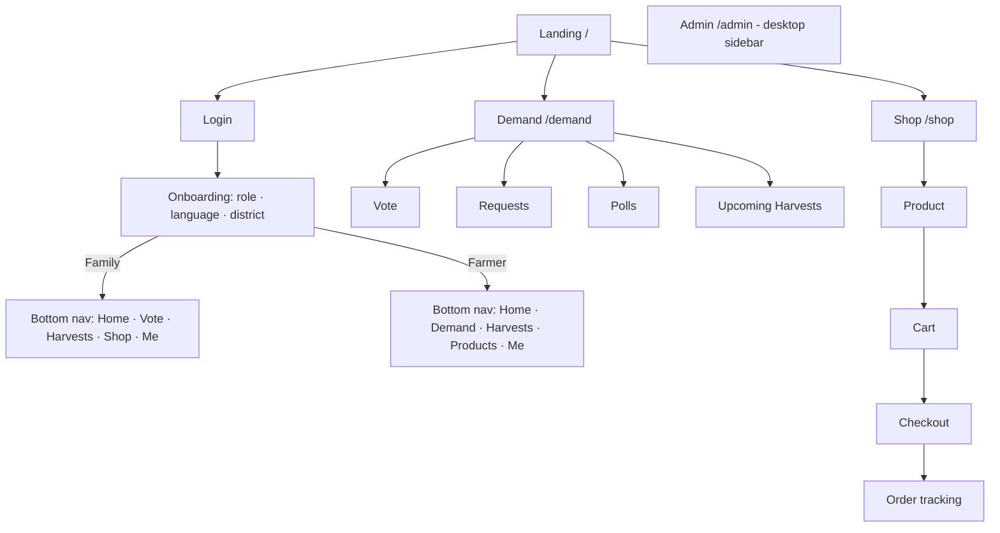

# Farmora MVP: UI/UX Design

Covers deliverables 10 (UI/UX wireframes), 11 (Landing page), 12 (Admin dashboard), 13 (Farmer dashboard), 14 (Customer dashboard) and 15 (Community Demand dashboard).

## 1. Design Principles

| Principle | In practice |
|---|---|
| **Mobile-first** | Designed at 360×640 first, then `sm 640 → md 768 → lg 1024 → xl 1280` |
| **Simple for farmers** | One primary action per screen, icon + label everywhere, big tap targets (≥ 48 px), native language by default, numbers in local format (₹1,24,500) |
| **Thumb-friendly** | Bottom navigation on mobile; primary buttons in the lower third |
| **Fast on 3G** | Server components, skeleton loaders, no heavy images above the fold, charts lazy-loaded |
| **Trust** | Real farmer photos and names, verified badges, clear "non-binding" labels on pre-order interest |
| **Accessible** | WCAG AA contrast, visible focus rings, `aria-live` for vote counts, no colour-only meaning |

### Design tokens (Tailwind)
```ts
// tailwind.config.ts → theme.extend.colors
leaf:    { 50: '#F1F8E9', 100: '#DCEDC8', 500: '#4CAF50', 600: '#2E7D32', 700: '#1B5E20' }, // primary
harvest: { 400: '#FFCA28', 500: '#F9A825' },  // votes, highlights, CTAs on dark
soil:    { 500: '#6D4C41', 700: '#4E342E' },  // secondary text, earthy accents
sky:     { 500: '#0288D1' },                  // info, weather
cream:   '#FAFAF5',                           // page background
```
Typography: **Inter** for Latin + **Noto Sans Telugu / Tamil / Devanagari** (via `next/font`). Body 16 px (18 px for farmer screens), headings 20/24/32 px.
Radius: `rounded-2xl` cards, `rounded-full` pills. Icons: `lucide-react`.

### Core components
`VoteCard` · `LeaderboardRow` · `TrendingChip` · `PollQuestion` · `HarvestCard` · `KpiCard` · `RegionBar` · `TrendLine` · `ProductCard` · `BottomNav` · `LanguageSwitcher` · `EmptyState` (with mascot "Chinnu the Sprout") · `Toast`

---

## 2. Information Architecture



---

## 3. Key Wireframes (Deliverable 10)

### 3.1 Login & Onboarding (mobile)
```
┌──────────────────────────┐  ┌──────────────────────────┐  ┌──────────────────────────┐
│        🌱 Farmora         │  │ ← Enter code             │  │ Welcome! Who are you?    │
│ Families Decide.         │  │ Sent to lak***@gmail.com │  │ ┌──────────┐┌──────────┐ │
│ Farmers Grow.            │  │                          │  │ │ 👨‍👩‍👧      ││ 👨‍🌾       │ │
│ Everyone Benefits.       │  │ [4][7][2][9][1][5]       │  │ │ Family   ││ Farmer   │ │
│                          │  │                          │  │ │ I buy    ││ I grow   │ │
│ [ G  Continue with Google]│  │ Resend in 0:45           │  │ └──────────┘└──────────┘ │
│ ─────── or ───────       │  │                          │  │ Language                 │
│ ✉ [email@example.com   ] │  │ [      Verify ✓       ]  │  │ (EN)(తెలుగు)(தமிழ்)(हिन्दी)│
│ [   Send login code    ] │  │                          │  │ District [Hyderabad ▾]   │
│                          │  │                          │  │ [      Continue →     ]  │
│ EN · తెలుగు · தமிழ் · हिन्दी │  │                          │  │                          │
└──────────────────────────┘  └──────────────────────────┘  └──────────────────────────┘
```

### 3.2 Vote screen (family, mobile)
```
┌──────────────────────────────┐
│ ← Vote · Rabi 2026-27        │
│ 🗳 7 of 10 votes left  ▓▓▓░░░░░░░│
│ [ Crops ] [ Products ]       │
│ 🔍 Search millets, dal…       │
├──────────────────────────────┤
│ ┌──────────────────────────┐ │
│ │ 🥜 Groundnut   వేరుశనగ    │ │
│ │ 500 families · #1         │ │
│ │ [ ✓ Voted ]  2 kg/mo ✎    │ │  ← voted state (filled green)
│ └──────────────────────────┘ │
│ ┌──────────────────────────┐ │
│ │ 🌾 Foxtail Millet  కొర్రలు │ │
│ │ 450 families · #2 ▲       │ │
│ │ [ 👍 Vote ]               │ │
│ └──────────────────────────┘ │
│ ┌──────────────────────────┐ │
│ │ 🍅 Organic Tomato         │ │
│ │ 300 families · #3         │ │
│ │ [ 👍 Vote ]               │ │
│ └──────────────────────────┘ │
│ Can't find it?               │
│ [ + Request a crop ]         │
├──────────────────────────────┤
│ 🏠 Home 🗳 Vote 🌾 Harvests 🛒 Shop 👤 Me │
└──────────────────────────────┘
```
After voting, a bottom sheet asks: *"How much would your family buy per month?"* `[ 1 ] [ 2 ] [ 5 ] [ __ ] kg` · `[Skip]`.

### 3.3 Request form
```
┌──────────────────────────────┐
│ ← Request a crop or product  │
│ Type     (● Crop)(○ Product) │
│ Name     [Black rice       ] │
│ Similar: Black Gram? [Vote]  │  ← live trigram suggestions
│ Monthly  [ 2 ] [kg ▾]        │
│ Season   (Kharif)(Rabi)(Any) │
│ ☑ Prefer organic             │
│ Notes    [_______________]   │
│ [        Submit request    ] │
│ You can submit 5 per day.    │
└──────────────────────────────┘
```

### 3.4 Poll
```
┌──────────────────────────────┐
│ ← Sankranti 2027 poll        │
│ Question 2 of 4   ●●○○       │
│ Which products would you     │
│ subscribe to every month?    │
│ ☑ Honey                      │
│ ☑ Ghee                       │
│ ☐ Cold-pressed oils          │
│ ☑ Millets                    │
│ ☐ Pulses                     │
│ [ ← Back ]       [ Next → ]  │
└──────────────────────────────┘
```
Results view: horizontal bars per option with %, "Based on 2,341 families".

### 3.5 Upcoming harvests
```
┌──────────────────────────────┐
│ Upcoming Harvests  📍Guntur ▾│
├──────────────────────────────┤
│ ┌────┐ Red Chilli · Teja     │
│ │img │ Ravi Farms ✔ Verified │
│ └────┘ 🗓 Harvest ~ 20 Jan    │
│        📦 2,000 kg · ~₹180/kg │
│        👨‍👩‍👧 132 families interested │
│        [ 🙋 I'm interested ]   │
│  ⓘ Non-binding. No payment.  │
├──────────────────────────────┤
│ ┌────┐ Foxtail Millet        │
│ │img │ Lakshmi FPO ✔         │
│ ...                          │
└──────────────────────────────┘
```

### 3.6 Product page & checkout (marketplace)
```
┌──────────────────────────────┐  ┌──────────────────────────────┐
│ ←                    ♡  🛒 2 │  │ ← Checkout                   │
│ [   product image carousel  ]│  │ Deliver to                   │
│ A2 Cow Ghee                  │  │ ◉ Home · Hyderabad 500032    │
│ 👨‍🌾 Lakshmi Farms ✔ · Kurnool │  │ [+ New address]              │
│ ★ 4.8 (120)                  │  │ ──────────────────────────── │
│ (250 ml)(● 500 ml)(1 L)      │  │ A2 Ghee 500 ml × 1   ₹649    │
│ ₹649  ̶₹̶7̶9̶9̶  19% off          │  │ Ragi 1 kg × 2        ₹178    │
│ In stock                     │  │ Delivery            FREE     │
│ [ Add to cart ] [ Buy now ]  │  │ Total               ₹827     │
│ Farm story · Reviews         │  │ [  Pay ₹827 · UPI/Card 🔒  ] │
└──────────────────────────────┘  └──────────────────────────────┘
```

---

## 4. Landing Page Design (Deliverable 11)

**Goal:** explain the idea in 5 seconds, show live community proof, get a vote within 60 seconds. Voting needs login, but browsing the leaderboard doesn't.

```
┌───────────────────────────────────────────────────────────────┐
│ 🌱 Farmora        Demand  Harvests  Shop  For Farmers   EN ▾ [Login]│
├───────────────────────────────────────────────────────────────┤
│                                                               │
│   Families Decide.                         ┌───────────────┐  │
│   Farmers Grow.                            │ 📊 Live now    │  │
│   Everyone Benefits.                       │ 1 Groundnut 500│  │
│                                            │ 2 Foxtail  450 │  │
│   Tell farmers what your family wants      │ 3 Tomato   300 │  │
│   to eat next season. They grow it.        │ 4 Turmeric 250 │  │
│   You buy it fresh, direct.                └───────────────┘  │
│                                                               │
│   [ 🗳 Vote now, it's free ]  [ 👨‍🌾 I'm a farmer ]            │
│                                                               │
│   12,430 families voted · 186 farmers · 42 upcoming harvests  │  ← get_public_stats()
├───────────────────────────────────────────────────────────────┤
│  HOW IT WORKS                                                 │
│  ① 🗳 Families vote    ② 📊 Farmers see demand   ③ 🌾 Farmers grow  ④ 🛒 Families buy direct │
├───────────────────────────────────────────────────────────────┤
│  🔥 TRENDING THIS WEEK   [Foxtail Millet ▲42%] [Ragi ▲30%] …   │
├───────────────────────────────────────────────────────────────┤
│  🌾 UPCOMING HARVESTS  (3 cards → "See all")                  │
├───────────────────────────────────────────────────────────────┤
│  FOR FARMERS                                                  │
│  "Know what to grow before you sow."                          │
│  ✓ Free demand dashboard  ✓ Sell direct  ✓ In your language   │
│  [ Join as a farmer ]                                         │
├───────────────────────────────────────────────────────────────┤
│  FROM THE FARM SHOP: Honey · Ghee · Oils · Millets · Pulses · Spices │
├───────────────────────────────────────────────────────────────┤
│  STORIES: farmer photo + quote · family photo + quote         │
├───────────────────────────────────────────────────────────────┤
│  FAQ: Is voting free? Is pre-order binding? How is my data used? │
├───────────────────────────────────────────────────────────────┤
│  Footer: About · Privacy · Terms · Contact · WhatsApp Channel · Instagram │
└───────────────────────────────────────────────────────────────┘
```

| Section | Notes |
|---|---|
| Hero | Tagline H1 (localised), 2 CTAs, live mini-leaderboard (ISR 60 s) |
| Social proof | Counters from `demand.get_public_stats()` |
| How it works | 4 icon steps, also as a 30-s explainer video (YouTube embed, lazy) |
| SEO | `metadata` per locale, `hreflang`, Open Graph image with tagline, JSON-LD `Organization` |
| Analytics events | `cta_vote_click`, `cta_farmer_click`, `leaderboard_view`, `signup_start` |
| Performance | Hero text-only above the fold; images lazy; LCP target < 2 s |

---

## 5. Community Demand Dashboard (Deliverable 15)

Public page `/demand`, the heart of Module 2. Anyone can view it; actions need login.

```
┌──────────────────────────────┐
│ Community Demand  Rabi 26-27 │
│ 📍 [All India ▾] [Hyderabad ▾]│
│ ┌──────┐┌──────┐┌──────┐     │
│ │12.4k ││86k   ││42    │     │
│ │families││votes ││harvests│  │
│ └──────┘└──────┘└──────┘     │
├──────────────────────────────┤
│ 🔥 Rising this week          │
│ [Foxtail ▲42%][Ragi ▲30%] →  │
├──────────────────────────────┤
│ 🏆 Top Crops     [Crops|Products]│
│ 1 🥜 Groundnut   ███████ 500  │
│ 2 🌾 Foxtail     ██████  450  │
│ 3 🍅 Org. Tomato ████    300  │
│ 4 🟡 Turmeric    ███     250  │
│ 5 🌾 Ragi        ██      180  │
│ [ See full leaderboard ]     │
├──────────────────────────────┤
│ 📋 Active polls (2)           │
│ Sankranti 2027 · 2 min · [Answer]│
├──────────────────────────────┤
│ 🌾 Upcoming harvests →        │
├──────────────────────────────┤
│ 🗳 You have 3 votes left  [Vote]│  ← sticky CTA when logged in
└──────────────────────────────┘
```

Desktop: three columns. Left = filters + KPIs; centre = leaderboard (tabs crops/products) + "Rising"; right = polls + harvests.

Data: `get_public_stats`, `get_trending`, `get_leaderboard`, `polls?status=eq.active`, `get_upcoming_harvests`.

---

## 6. Farmer Dashboard (Deliverable 13)

Simple language, big numbers, and one clear message per card.

### 6.1 Farmer Home (mobile)
```
┌──────────────────────────────┐
│ నమస్తే రవి 👋   ☀ 31° Guntur  │
├──────────────────────────────┤
│ 💡 Families near you want:    │
│  🌾 Foxtail Millet  ▲42%     │
│  [ See demand → ]            │
├──────────────────────────────┤
│ ┌─────────┐ ┌─────────┐      │
│ │ 🌱 3     │ │ 🛒 12    │      │
│ │ crops    │ │ new orders│     │
│ └─────────┘ └─────────┘      │
│ ┌─────────┐ ┌─────────┐      │
│ │ 🙋 132   │ │ ₹48,200  │      │
│ │ interested│ │ sales/mo │     │
│ └─────────┘ └─────────┘      │
├──────────────────────────────┤
│ 📅 Today                      │
│ ☐ 💧 Irrigate chilli field   │
│ ☐ 🧪 Urea 50 kg – cotton     │
├──────────────────────────────┤
│ 📈 Mandi: Chilli ₹18,500/q ▲3%│
├──────────────────────────────┤
│ 🏠 Home 📊 Demand 🌾 Harvests 📦 Products 👤 Me│
└──────────────────────────────┘
```

### 6.2 Demand Dashboard (farmer)
```
┌──────────────────────────────┐
│ 📊 Demand       Rabi 2026-27 │
│ 📍 (My district)(My state)(India)│
│ [Most voted][Most requested][Regions][Trends]│
├──────────────────────────────┤
│ MOST VOTED CROPS · Guntur    │
│ 1 Groundnut     500 · 1.2t/mo│
│ 2 Foxtail Millet 450 · 0.9t/mo│
│ 3 Organic Tomato 300 · 0.6t/mo│
│ 4 Turmeric      250 · 0.3t/mo│
│  Tap a crop for full report → │
├──────────────────────────────┤
│ MOST REQUESTED (90 days)     │
│ Black rice   38 req · 🌿 82% organic│
│ Kodo millet  21 req · 🌿 64%  │
├──────────────────────────────┤
│ 💡 Suggestion                 │
│ "Foxtail Millet: high demand,│
│ Kharif crop, suits red soil."│  ← rule-based recommendation
└──────────────────────────────┘
```

### 6.3 Consumer Interest Report (per crop)
```
┌──────────────────────────────┐
│ ← Foxtail Millet report      │
│ 450 votes · 0.9 t/month      │
│ 21 requests · 64% organic    │
│ 132 families pre-order interest│
├──────────────────────────────┤
│ 📍 Demand by region           │
│ Hyderabad  ██████████ 210    │
│ Guntur     █████ 95          │
│ Chennai    ████ 80           │
│ (areas < 3 families hidden)  │
├──────────────────────────────┤
│ 📈 Seasonal trend (12 mo)     │
│  ▁▂▂▃▅▆▇█▆▅▃▂  votes          │
│  Kharif 26: 120 · Rabi 26-27: 450│
├──────────────────────────────┤
│ [ 🌾 Announce my harvest ]    │
│ [ ⬇ Download CSV ] [ Share 📤 ]│
└──────────────────────────────┘
```

### 6.4 Harvests & Pre-order Interest Report
```
┌──────────────────────────────┐
│ My Harvests     [+ Announce] │
├──────────────────────────────┤
│ Red Chilli · 20 Jan · 2,000 kg│
│ 🙋 132 families · 860 kg      │
│  Hyderabad  70 · 450 kg      │
│  Vijayawada 38 · 260 kg      │
│  Guntur     24 · 150 kg      │
│ [Mark harvested] [Edit]      │
└──────────────────────────────┘
```
Other farmer tabs: **Farms & Crops** (cards with sowing/harvest progress bar), **Products** (list, stock badges, "Low stock" warnings, + Add product wizard in 3 steps), **Orders** (grouped by status, one-tap "Packed", "Shipped" + tracking number).

---

## 7. Customer (Family) Dashboard (Deliverable 14)

`/account`: what I've asked for and what I've bought.
```
┌──────────────────────────────┐
│ 👤 Lakshmi · Hyderabad   ⚙   │
│ ⭐ 240 points · Invite friends│
├──────────────────────────────┤
│ 🗳 My voice this season       │
│ 7 votes · 2 requests · 1 poll │
│ Your top pick: Groundnut #1 🎉│
│ [Manage votes]               │
├──────────────────────────────┤
│ 🙋 Harvests I'm waiting for   │
│ Red Chilli · ~20 Jan · 2 kg  │
├──────────────────────────────┤
│ 📦 Orders                     │
│ FRM100245 · Shipped 🚚 [Track]│
│ FRM100198 · Delivered ✓ [Review]│
├──────────────────────────────┤
│ ♡ Wishlist (4) · 📍 Addresses │
│ 🔔 Notifications (3)          │
│ 🌐 Language · Privacy · Delete account │
└──────────────────────────────┘
```
Referral card: "Invite a family → you both get 100 points when they place their first order" with a WhatsApp share button (`https://wa.me/?text=…?ref=CODE`).

---

## 8. Admin Dashboard (Deliverable 12)

Desktop-first (works on tablet). Left sidebar; data tables with search, filters and CSV export.

### 8.1 Overview
```
┌────────────┬──────────────────────────────────────────────────────────────┐
│ 🌱 Admin    │ Overview                   [7d][30d][Season]   ⬇ Export     │
│ 📊 Overview │ ┌────────┐┌────────┐┌────────┐┌────────┐┌────────┐┌────────┐  │
│ 🗳 Demand   │ │Families││Votes 7d││Pending ││Orders  ││GMV     ││Farmers │  │
│  ├ Analytics│ │ 12,430 ││ 8,120  ││req. 37 ││ 1,284  ││₹8.3 L  ││ 186    │  │
│  ├ Polls    │ └────────┘└────────┘└────────┘└────────┘└────────┘└────────┘  │
│  ├ Requests │ ┌─ Votes per day (line) ──────────┐ ┌─ Top items ────────────┐ │
│  ├ Items    │ │                                 │ │ 1 Groundnut   500      │ │
│  └ Seasons  │ └─────────────────────────────────┘ │ 2 Foxtail     450      │ │
│ 👨‍🌾 Farmers  │ ┌─ Revenue (bar) ─────────────────┐ └────────────────────────┘ │
│ 👥 Customers│ │                                 │ ┌─ Needs attention ───────┐ │
│ 📦 Products │ └─────────────────────────────────┘ │ ⏳ 37 requests to review │ │
│ 🧾 Orders   │                                     │ ⏳ 9 products to approve │ │
│ 📈 Reports  │                                     │ ⏳ 4 farmers to verify   │ │
│ ⚙ Settings │                                     │ ⚠ 6 SKUs low stock      │ │
└────────────┴──────────────────────────────────────────────────────────────┘
```

### 8.2 Request moderation
```
┌──────────────────────────────────────────────────────────────────────┐
│ Requests  [Pending 37] [Approved] [Merged] [Rejected]   🔍           │
├──────────────────────────────────────────────────────────────────────┤
│ "Black rice" · crop · 2 kg/mo · organic · Hyderabad · 2h ago          │
│  Similar items: — none —                                              │
│  [✓ Approve as new item] [⇢ Merge into… ▾] [✕ Reject: note…]          │
├──────────────────────────────────────────────────────────────────────┤
│ "Foxtail millet rice" · crop · Pune · 3h ago                           │
│  Similar items: Foxtail Millet (92% match)                            │
│  [✓ Approve] [⇢ Merge into Foxtail Millet] [✕ Reject]                 │
└──────────────────────────────────────────────────────────────────────┘
```

### 8.3 Poll builder
```
┌──────────────────────────────────────────────────────────────────────┐
│ New poll                                         [Save draft] [Publish]│
│ Title (EN) [Sankranti 2027: what should we grow?]  [TE][TA][HI] tabs │
│ Audience  (● Everyone)(○ State [▾])(○ District [▾])                    │
│ Opens [11 Oct 2026] Closes [10 Jan 2027]   ☑ Results public           │
│ ── Q1 ─ Single choice ─────────────────────────────── [↑][↓][🗑]       │
│   Prompt [Which crop would you most like to buy…]                     │
│   Options: [Groundnut ⛓][Foxtail Millet ⛓][Organic Tomato ⛓][+ Add]  │  ⛓ = link to demand item
│ ── Q2 ─ Rating 1–5 ──────────────────────────────────                 │
│ [+ Add question: Single | Multi | Rating | Text]                      │
└──────────────────────────────────────────────────────────────────────┘
```

### 8.4 Demand analytics & reports
- KPIs from `demand.admin_overview()`
- Leaderboard by state/district with crop/product toggle
- Requests over time; approval rate
- Poll results with per-region split
- Pre-order interest by harvest
- **Exports:** leaderboard CSV, region CSV, poll results CSV, requests CSV
- Marketplace reports: orders by status, revenue by day/category/farmer, inventory (stock, reserved, low stock)

Other admin pages: **Farmers** (verify, view products/orders), **Customers** (search, ban via `/api/admin/users/:id/ban`), **Products** (approval queue with image preview and reject reason), **Orders** (filter, change status, cancel → refund).

---

## 9. Responsive Behaviour Summary

| Screen | Mobile (< 768) | Desktop (≥ 1024) |
|---|---|---|
| Navigation | Bottom nav (5 icons) | Top nav (public) / left sidebar (farmer, admin) |
| Leaderboard | Single column, bars inline | Table with region filter panel |
| Dashboards | Stacked KPI cards (2 per row) | 4–6 KPI cards per row + charts side by side |
| Forms | Full-screen steps | Two-column with live preview |
| Admin | Read-mostly; key actions only | Full data tables |
