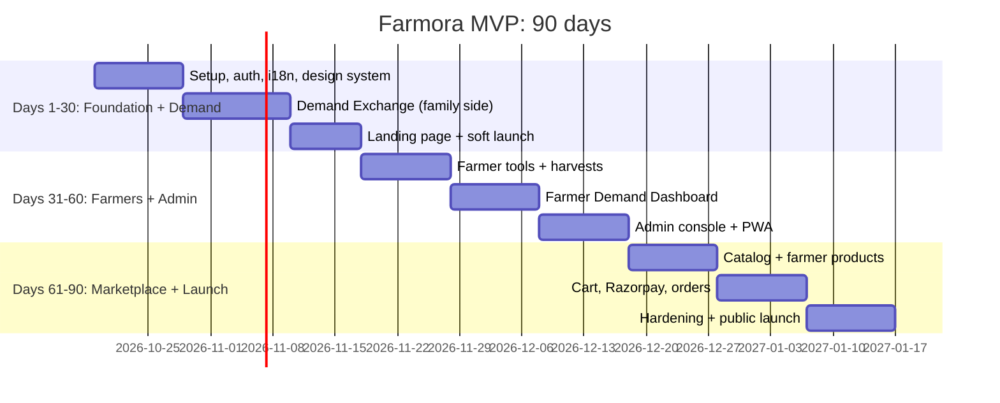

# Farmora MVP: Development Roadmap (30 / 60 / 90 Days)

Covers deliverable 16. Assumes 1–2 full-stack developers and a part-time designer, all on free tools. Start date: **Mon 19 Oct 2026**.

---

## Days 1–30: Foundation + Community Demand Exchange (family side)

**Goal:** families can sign up and vote. Demand data starts flowing on day 30.

| Week | Deliverables |
|---|---|
| **1** | GitHub repo, Next.js 15 + TS + Tailwind + shadcn/ui, ESLint/Prettier, CI workflow. Supabase project + migrations `core`, `demand`, `storage` + seed. Vercel project with preview deploys. `next-intl` with en/te/ta/hi |
| **2** | Auth: Google OAuth + Email OTP (Brevo SMTP), `/auth/callback`, middleware session refresh, onboarding (role, language, district). Profile settings. GA4 with consent banner |
| **3** | Demand: items list (crops/products), vote / unvote with optimistic UI and 10-vote meter, quantity sheet, requests form + "My requests", leaderboard (`get_leaderboard`) with region filter, trending strip |
| **4** | Polls (list, answer, results), upcoming harvests (read-only for now), `/demand` dashboard, **landing page** with live stats, WhatsApp share buttons, SEO (sitemap, OG images). Seed with sample polls. **Soft launch to 200 families** (friends, 2 apartment communities) |

**Day-30 exit criteria**
- [ ] 200+ families signed up, 1,000+ votes
- [ ] All 4 languages complete for demand screens
- [ ] Lighthouse mobile ≥ 90 on landing and `/demand`
- [ ] RLS tests pass (pgTAP): users can't read others' votes or write other users' rows
- [ ] ₹0 spent

---

## Days 31–60: Farmer Side + Admin Console

**Goal:** farmers see demand and announce harvests. Admins run the community.

| Week | Deliverables |
|---|---|
| **5** | Farmer onboarding + storefront profile. Farms & crops (sowing/harvest dates, photos with client-side WebP compression), simple task list |
| **6** | **Harvest announcements** + family "I'm interested" + **pre-order interest report**. Notifications inbox |
| **7** | **Farmer Demand Dashboard:** most voted, most requested, demand by region, seasonal trends, cycle history, consumer interest report, CSV export. Rule-based crop suggestion card. Weather + mandi price widgets (GitHub Actions daily job) |
| **8** | **Admin console:** demand analytics, poll builder (multilingual, region targeting), request moderation (approve/merge/reject), items & seasons, farmer verification, user list. PWA manifest + install prompt. Onboard **25 founding farmers** in person |

**Day-60 exit criteria**
- [ ] 25+ farmers, 1,000+ families, 10,000+ votes
- [ ] At least 10 harvest announcements with pre-order interest
- [ ] Every pending request reviewed within 48 h
- [ ] Nightly encrypted backup job running
- [ ] Still ₹0 (except optional domain)

---

## Days 61–90: Marketplace + Public Launch

**Goal:** families can buy farm products. Public launch.

| Week | Deliverables |
|---|---|
| **9** | Marketplace migration. Categories, farmer product wizard (variants, stock, images), admin product approval, shop browse/search/filter, product page with farmer story |
| **10** | Cart, wishlist, addresses, **Razorpay checkout** (test mode → live after KYC), `/api/checkout`, `/api/payments/verify`, webhook, order expiry cron, order tracking, farmer fulfilment, reviews |
| **11** | Hardening: security headers/CSP, rate-limit review, error tracking (Sentry), Playwright E2E (vote, poll, checkout), accessibility audit, legal pages (Privacy (DPDP), Terms, Refund, Shipping). **Hosting switch for commercial use:** Vercel Pro or Cloudflare (see architecture §2.1) |
| **12** | **Public launch** "Families Decide. Farmers Grow." (see launch strategy). Monitor, fix, iterate. Retrospective + next-quarter plan |

**Day-90 exit criteria**
- [ ] 5,000+ families, 50+ farmers, 100+ paid orders
- [ ] Payment success rate ≥ 95%, zero overselling incidents
- [ ] p95 page load < 3 s on 4G
- [ ] Monthly infra spend ≤ ₹1,700 (only if hosting moved to a paid commercial plan)

---

## After Day 90 (next quarter)
| Priority | Item |
|---|---|
| P1 | Referral rewards UI + points redemption as discounts (loyalty) |
| P1 | Coupons, subscription boxes |
| P1 | AI crop recommendation v1 (rules + demand), demand forecasting v1 (seasonal moving averages) |
| P2 | On-device AI disease detection (TensorFlow.js) |
| P2 | WhatsApp Cloud API notifications (opt-in) |
| P2 | Farmer community features ([docs/10-community.md](../10-community.md)) |
| P2 | Capacitor / React Native app shells for Play Store |

## Working Agreements
- Trunk-based development; every PR gets a Vercel preview and CI checks.
- Every migration has a pgTAP test for its RLS policies.
- Weekly 30-minute demo to 3 farmers and 3 families; their feedback sets next week's priorities.
- Definition of done: works at 360 px, translated in 4 languages, analytics event added, tests green.
